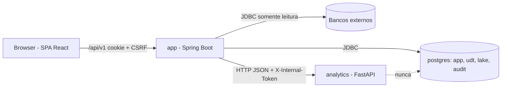
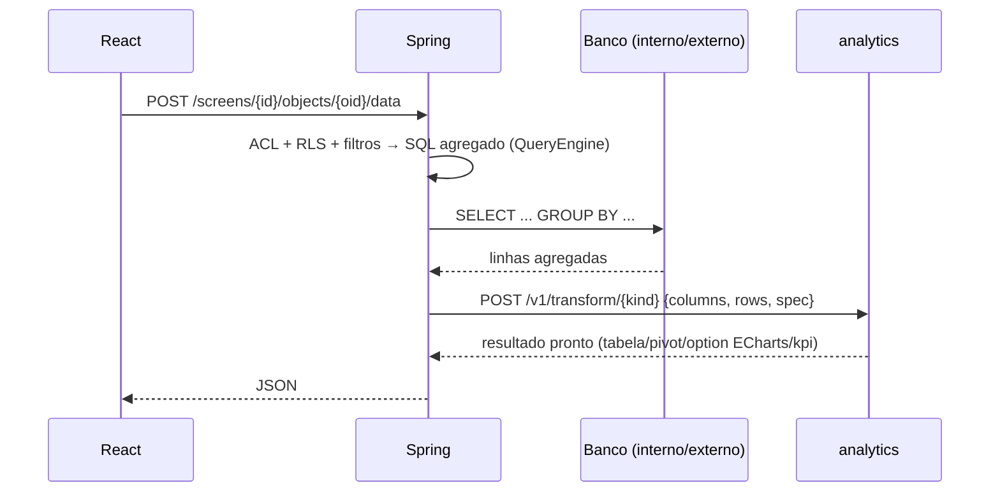

# F00 — Fundação Design

**Spec**: `.specs/features/F00-fundacao/spec.md`
**Status**: Draft

Este documento também é a **referência de arquitetura global** do DataBoard. As demais features citam suas seções em vez de repetir.

---

## Architecture Overview



**Fluxo de dados de um objeto** (AD-003), usado a partir da F19:



### Layout do repositório

```
DataBoard/
├── Makefile
├── backend/                     # Maven, Java 25, Spring Boot 4
│   ├── mvnw, pom.xml
│   └── src/main/java/io/databoard/
│       ├── DataBoardApplication.java
│       ├── platform/            # erros, paginação, web, config, jobs, analytics client
│       ├── security/  audit/  datasource/  udt/  importing/
│       ├── semantic/  query/  dashboard/  catalog/  navigation/
│       └── ...                  # um pacote de topo = um módulo Spring Modulith
├── analytics/                   # uv, Python 3.13, FastAPI
│   ├── pyproject.toml, uv.lock, openapi.json
│   ├── src/databoard_analytics/
│   │   ├── main.py  security.py  logging.py
│   │   ├── api/                 # routers v1
│   │   └── transforms/          # lógica pura (polars)
│   └── tests/{unit,api}/
├── frontend/                    # Vite, React 19, TS, Mantine
│   ├── src/{app,features,shared}/
│   └── e2e/                     # Playwright
└── deploy/
    ├── docker-compose.yml       # oficial (F01)
    ├── docker-compose.dev.yml
    └── scripts/
```

---

## Code Reuse Analysis

### Existing Components to Leverage

| Component | Location | How to Use |
| --- | --- | --- |
| — | — | Repositório vazio; nada a reaproveitar. |
| Spring `ProblemDetail` | Spring Framework 6+/7 | Base do handler RFC 9457; estender com propriedade `code` |
| Spring Modulith `ApplicationModules.verify()` | spring-modulith-core | Teste de arquitetura |
| `RestClient` | Spring Framework | Cliente HTTP do analytics |
| FastAPI `app.openapi()` | FastAPI | Gerar `openapi.json` |

### Integration Points

| System | Integration Method |
| --- | --- |
| Postgres | Flyway `V1__schemas.sql` cria `app`, `udt`, `lake`, `audit` |
| analytics | `AnalyticsClient` (RestClient), base URL `DATABOARD_ANALYTICS_URL` (padrão `http://analytics:8000`) |

---

## Components

### Backend — `platform.web.ProblemDetailsHandler`

- **Purpose**: Converter exceções em `application/problem+json` com `code` estável.
- **Location**: `backend/src/main/java/io/databoard/platform/web/`
- **Interfaces**:
  - `DomainException(String code, HttpStatus status, String detail, Map<String,Object> extras)`: base de todas as exceções de negócio.
  - `@RestControllerAdvice ProblemDetailsHandler`: mapeia `DomainException`, `MethodArgumentNotValidException` (→ `VALIDATION_ERROR` + `errors[]`) e `Exception` (→ `INTERNAL_ERROR`).
- **Dependencies**: Spring Web MVC.

### Backend — `platform.web.PageResponse<T>`

- **Purpose**: Envelope `{ content, page, size, totalElements }`.
- **Interfaces**: `static <T> PageResponse<T> of(Page<T>)`.

### Backend — `platform.web.RequestIdFilter`

- **Purpose**: Gera/propaga `X-Request-Id`, coloca no MDC e devolve no header da resposta.

### Backend — `platform.analytics.AnalyticsClient`

- **Purpose**: Único ponto de saída para o analytics.
- **Interfaces**:
  - `<T> T post(String path, Object body, Class<T> type)`: adiciona `X-Internal-Token` e `X-Request-Id`, timeout de 10 s.
  - Erros: conexão/timeout → `AnalyticsUnavailableException` (503 `ANALYTICS_UNAVAILABLE`); 4xx/5xx → `AnalyticsErrorException` (502 `ANALYTICS_ERROR`).
- **Config**: `databoard.analytics.url`, `databoard.analytics.token`, `databoard.analytics.timeout=10s`.

### Backend — `platform.web.SpaForwardController`

- **Purpose**: Fallback `GET /{path:^(?!api|actuator).*}` → `forward:/index.html`.

### analytics — `security.InternalTokenMiddleware`

- **Purpose**: Rejeita `/v1/*` sem token válido (comparação em tempo constante, `hmac.compare_digest`).
- **Location**: `analytics/src/databoard_analytics/security.py`

### analytics — `api.v1.echo`

- **Purpose**: Endpoint `POST /v1/echo` usado só nos testes de contrato.

### analytics — `logging.configure()`

- **Purpose**: Logs JSON (structlog ou `logging` + formatter) com `requestId` vindo do header.

### Frontend — shell mínimo

- **Purpose**: `MantineProvider`, `QueryClientProvider`, `RouterProvider` e página placeholder "DataBoard".
- **Location**: `frontend/src/app/`
- **Shared**: `frontend/src/shared/api/http.ts` (fetch com CSRF e parse de problem+json → `ApiError { status, code, detail, errors }`).

### Makefile

| Alvo | Comando |
| --- | --- |
| `dev` | `docker compose -f deploy/docker-compose.dev.yml up -d --build` |
| `dev-front` | `cd frontend && npm run dev` |
| `test-backend` | `cd backend && ./mvnw -q test` |
| `it-backend` | `cd backend && ./mvnw -q verify -DskipUnitTests` (Failsafe, `*IT.java`, Testcontainers) |
| `test-analytics` | `cd analytics && uv run pytest` |
| `test-frontend` | `cd frontend && npm run test -- --run` |
| `lint` | `ruff check` + `ruff format --check` + `pyright` + `npm run lint` + `npm run typecheck` + `./mvnw -q spotless:check` |
| `contract` | `cd analytics && uv run python -m databoard_analytics.export_openapi --check` |
| `build` | `./mvnw -q package -DskipTests` (inclui build do front) |
| `e2e` | `cd frontend && npx playwright test` |
| `ci` | `lint contract build test-backend it-backend test-analytics test-frontend e2e` |

---

## Data Models

### Flyway `V1__schemas.sql`

```sql
CREATE SCHEMA IF NOT EXISTS app;
CREATE SCHEMA IF NOT EXISTS udt;
CREATE SCHEMA IF NOT EXISTS lake;
CREATE SCHEMA IF NOT EXISTS audit;
```

### Contrato base do analytics (usado a partir da F19)

```python
class Column(BaseModel):
    key: str
    label: str
    type: Literal["TEXT","INTEGER","DECIMAL","DATE","DATETIME","BOOLEAN"]
    role: Literal["DIMENSION","MEASURE"]
    maskId: str | None = None

class TransformRequest(BaseModel):
    columns: list[Column]
    rows: list[list[Any]]      # resultado já agregado pelo banco
    spec: dict                 # específico do kind (table/pivot/chart/kpi)
```

---

## Error Handling Strategy

| Error Scenario | Handling | User Impact |
| --- | --- | --- |
| analytics fora do ar / timeout | `AnalyticsUnavailableException` → 503 `ANALYTICS_UNAVAILABLE` | Objeto mostra "Serviço de análise indisponível" (RN-19.1 isola por objeto) |
| analytics devolve erro | 502 `ANALYTICS_ERROR`, corpo original logado | Mensagem genérica no objeto |
| Exceção não tratada | 500 `INTERNAL_ERROR`, sem stack no corpo | "Erro inesperado (id: <requestId>)" |
| Token interno errado | analytics 401 | Nenhum (só em configuração errada; aparece no log) |

---

## Risks & Concerns

| Concern | Location (file:line) | Impact | Mitigation |
| --- | --- | --- | --- |
| Spring Boot 4 + Java 25 com ecossistema ainda amadurecendo (plugins Maven, Testcontainers) | `backend/pom.xml` (a criar) | Incompatibilidade de plugin | Validar versões na T1; fixar versões no BOM; se bloquear, documentar e cair para a última 3.x com supersessão de AD-012 |
| Token interno fraco ou ausente em dev | `deploy/docker-compose.dev.yml` | analytics aberto na rede local | Compose dev gera valor fixo apenas para dev; F01 torna obrigatório em produção |
| Build do front dentro do Maven deixa o `package` lento | `backend/pom.xml` | CI lenta | Perfil `-Pskip-frontend` para testes de backend |

---

## Tech Decisions (only non-obvious ones)

| Decision | Choice | Rationale |
| --- | --- | --- |
| Separar unit × integration no Maven | Surefire (`*Test`) e Failsafe (`*IT`) | Gate quick sem containers |
| Formatação Java | Spotless + google-java-format | Lint determinístico no `make lint` |
| Logs JSON no Spring | Structured logging nativo do Spring Boot (`logging.structured.format.console=ecs`) | Sem dependência extra |
