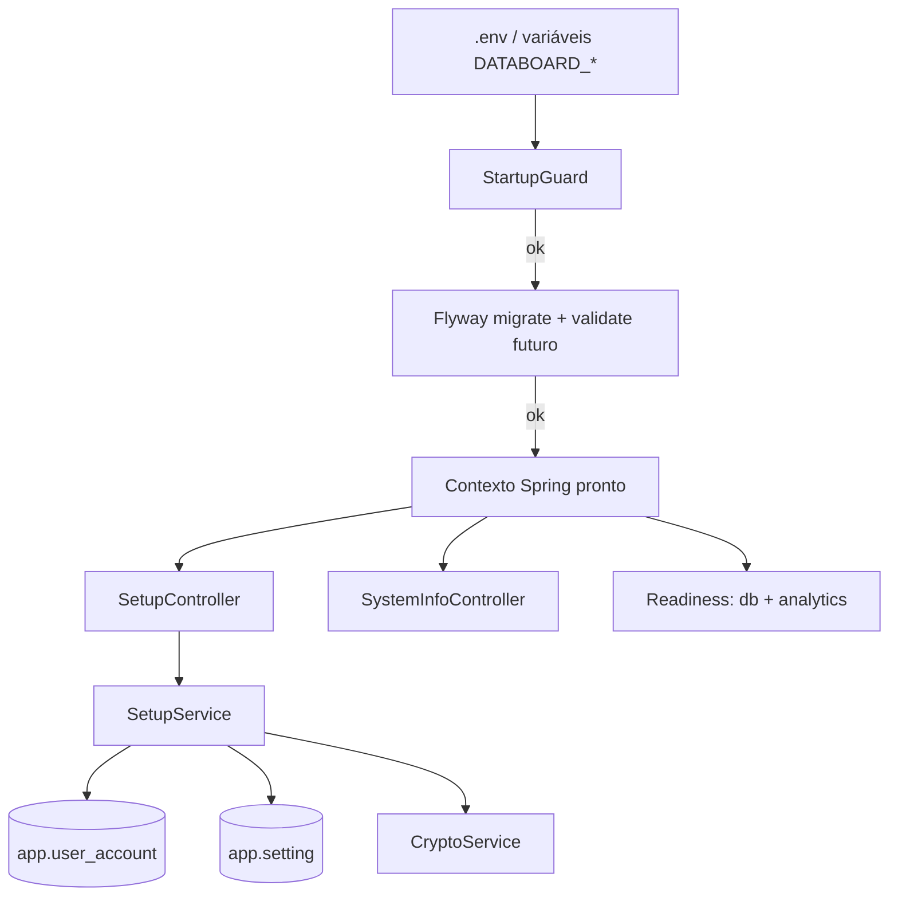

# F01 — Distribuição e Instalação Design

**Spec**: `.specs/features/F01-instalacao/spec.md`
**Status**: Draft

---

## Architecture Overview



O `StartupGuard` roda como `EnvironmentPostProcessor`, antes de qualquer bean, para falhar cedo com mensagem clara. A proteção contra downgrade usa a validação nativa do Flyway com `spring.flyway.ignore-migration-patterns=""`: o padrão `*:future` deixaria passar migrações futuras.

---

## Code Reuse Analysis

### Existing Components to Leverage

| Component | Location | How to Use |
| --- | --- | --- |
| `DomainException` / `ProblemDetailsHandler` | `backend/.../platform/web/` (F00) | Erros `VALIDATION_ERROR`, 404 do setup |
| `AnalyticsClient` | `backend/.../platform/analytics/` (F00) | Base do health indicator do analytics |
| `http.ts` / `ApiError` | `frontend/src/shared/api/http.ts` (F00) | Chamadas do wizard |
| Compose de dev | `deploy/docker-compose.dev.yml` (F00) | Base do compose oficial |

### Integration Points

| System | Integration Method |
| --- | --- |
| Postgres | Flyway `V2__user_and_settings.sql` |
| Actuator | Grupo `readiness` = `db` + `analytics` |
| Maven | `spring-boot-maven-plugin` `build-info` + `git-commit-id-maven-plugin` |

---

## Components

### `platform.config.StartupGuard` (EnvironmentPostProcessor)

- **Purpose**: Validar `DATABOARD_SECRET_KEY` (≥ 32) e `DATABOARD_INTERNAL_TOKEN` antes do contexto subir.
- **Location**: `backend/src/main/java/io/databoard/platform/config/StartupGuard.java`
- **Interfaces**: `postProcessEnvironment(env, app)`: lança `IllegalStateException` com mensagem pt-BR. Registrado em `META-INF/spring/org.springframework.boot.EnvironmentPostProcessor.imports`.

### `platform.crypto.CryptoService`

- **Purpose**: Cifrar e decifrar segredos (SMTP, conexões).
- **Interfaces**:
  - `String encrypt(String plain)`: formato `v1:<base64(nonce|ciphertext|tag)>`.
  - `String decrypt(String token)`: lança `DomainException(CREDENTIAL_UNREADABLE)` em falha de tag.
- **Dependencies**: JCA (`AES/GCM/NoPadding`), HKDF implementado com `Mac` HmacSHA256 (RFC 5869).

### `security.user.UserAccount` + `UserAccountRepository`

- **Purpose**: Usuário mínimo (estendido em F03/F04).
- **Location**: `backend/src/main/java/io/databoard/security/user/`
- **Interfaces**: `long count()`, `Optional<UserAccount> findByEmailIgnoreCase(String)`.

### `platform.settings.SettingsStore`

- **Purpose**: Chave-valor por seção (`general`, `smtp`…). A F02 constrói a API em cima dele.
- **Interfaces**: `<T> T get(String section, Class<T>)`, `void put(String section, Object value)` (JSON via Jackson).

### `platform.setup.SetupService` / `SetupController`

- **Purpose**: Fluxo do wizard.
- **Interfaces**:
  - `boolean setupRequired()`: `userRepository.count() == 0`.
  - `void complete(SetupRequest)`: `@Transactional`, `pg_advisory_xact_lock(hashtext('setup'))`, revalida `count()==0` (senão `SetupNotAvailableException` → 404), cria o admin, grava `general` e `smtp` (senha cifrada).
  - `GET /api/v1/setup/status`, `POST /api/v1/setup`, ambos públicos.

### `platform.system.SystemInfoController`

- **Purpose**: `GET /api/v1/system/info` a partir de `BuildProperties`, `GitProperties` e `Flyway.info().current()`.

### `platform.analytics.AnalyticsHealthIndicator`

- **Purpose**: `GET {analytics}/health`; `DOWN` se falhar. Incluído no grupo `readiness`.

### Frontend — `features/setup/`

- `SetupGate` (layout raiz): consulta `/setup/status` via TanStack Query; se `setupRequired`, redireciona para `/setup`.
- `SetupWizardPage`: Mantine `Stepper` com 3 passos: Empresa (nome + fuso), Administrador, SMTP opcional.
- `features/system/AboutPage`.

### Distribuição

- `deploy/docker-compose.yml`: imagens publicadas, `env_file: .env`, volumes `databoard-db` e `databoard-files` (montado em `/var/lib/databoard/files`), healthchecks, `analytics` sem `ports`.
- `deploy/.env.example`: todas as `DATABOARD_*` comentadas.
- `deploy/scripts/backup.sh` e `restore.sh` (bash, `set -euo pipefail`, `docker compose exec postgres pg_dump -Fc`).
- `.github/workflows/release.yml`: `docker/build-push-action` com `platforms: linux/amd64,linux/arm64`.

---

## Data Models

```sql
-- V2__user_and_settings.sql
CREATE TABLE app.user_account (
  id            uuid PRIMARY KEY,
  name          varchar(200) NOT NULL,
  email         varchar(320) NOT NULL,
  password_hash varchar(200) NOT NULL,
  role          varchar(20)  NOT NULL CHECK (role IN ('ADMIN','BUILDER','VIEWER')),
  status        varchar(20)  NOT NULL DEFAULT 'ACTIVE',
  created_at    timestamptz  NOT NULL DEFAULT now(),
  updated_at    timestamptz  NOT NULL DEFAULT now()
);
CREATE UNIQUE INDEX ux_user_email ON app.user_account (lower(email));

CREATE TABLE app.setting (
  section    varchar(40) PRIMARY KEY,
  value      jsonb       NOT NULL,
  updated_at timestamptz NOT NULL DEFAULT now(),
  updated_by uuid
);
```

```java
record SetupRequest(@NotBlank String companyName, @ValidTimezone String timezone,
                    @Valid AdminInput admin, @Valid SmtpInput smtp /* nullable */) {}
```

---

## Error Handling Strategy

| Error Scenario | Handling | User Impact |
| --- | --- | --- |
| Variável obrigatória ausente | `StartupGuard` aborta; exit ≠ 0 | Log claro no `docker compose logs app` |
| Setup já concluído | 404 (RN-01.1) | Wizard inacessível |
| Banco mais novo | Flyway `ValidateException` → startup aborta, log pt-BR | Container reinicia em loop com log explícito |
| Chave trocada | `CREDENTIAL_UNREADABLE` (422) ao usar a credencial | Mensagem "recadastre a senha" |

---

## Risks & Concerns

| Concern | Location (file:line) | Impact | Mitigation |
| --- | --- | --- | --- |
| Wizard público pode ser sequestrado entre o deploy e o primeiro acesso | `SetupController` | Terceiro cria o admin | Documentar em `docs/operacao.md`: acessar o wizard imediatamente; RN-01.1 garante janela única |
| Build multi-arch lento (arm64 emulado) | `release.yml` | Release demorada | Cache do buildx; aceitável por rodar só em tag |
| `pg_dump` dentro do container exige versão compatível | `backup.sh` | Dump falha | Usar o binário do próprio container `postgres:17` |

---

## Tech Decisions (only non-obvious ones)

| Decision | Choice | Rationale |
| --- | --- | --- |
| Validação de env | `EnvironmentPostProcessor` em vez de `@ConfigurationProperties @Validated` | Falha antes do Flyway e do datasource, com mensagem única |
| Concorrência do setup | Advisory lock transacional | Evita dois admins sem tabela extra |
| Downgrade | Validação nativa do Flyway com padrão `future` desligado | Zero código próprio |
