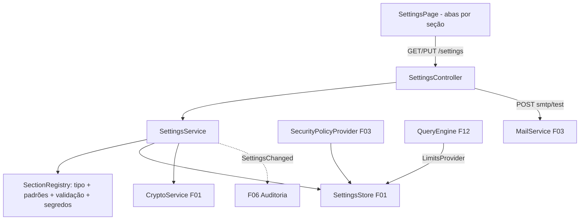

# F02 — Configurações Gerais Design

**Spec**: `.specs/features/F02-configuracoes/spec.md`
**Status**: Draft

---

## Architecture Overview



Cada seção é um `record` Java com Bean Validation e um método `defaults()`. O `SectionRegistry` mapeia `nome → (classe, padrões, campos secretos)`, o que permite um único controller genérico.

---

## Code Reuse Analysis

### Existing Components to Leverage

| Component | Location | How to Use |
| --- | --- | --- |
| `SettingsStore` | `platform/settings` (F01) | Persistência |
| `CryptoService` | `platform/crypto` (F01) | Senha SMTP |
| `SecurityPolicyProvider` | `security/auth` (F03) | Passa a usar o record `SecuritySettings` desta feature |
| `MailService` | `notification/mail` (F03) | Teste de SMTP (aceitar config ad hoc para testar antes de gravar não é necessário: testa o que está gravado) |
| `@PreAuthorize("hasRole('ADMIN')")` | F04 | Proteção |

### Integration Points

| System | Integration Method |
| --- | --- |
| F03 | `SecurityPolicyProvider` lê `SecuritySettings` |
| F12 | `LimitsProvider.current()` lê `LimitsSettings` |
| F06 | Evento `SettingsChanged` |
| Preferências do usuário | Coluna `preferences jsonb` em `user_account` (V5) + `PUT /api/v1/me/preferences` |

---

## Components

### `platform.settings.sections.*`

- `GeneralSettings(companyName, timezone, dateFormat, numberFormat, currency, defaultPageSize)`
- `SecuritySettings(passwordMinLength, passwordRequireLetterAndDigit, passwordExpiryDays, passwordHistory, lockoutAttempts, lockoutMinutes, sessionIdleMinutes, sessionMaxHours)`
- `LimitsSettings(queryTimeoutSeconds, maxQueryRows, maxExportRows)`
- `SmtpSettings(host, port, username, password /*secret*/, fromAddress, tls)`
- `AppearanceSettings(defaultTheme)`
- **Location**: `backend/src/main/java/io/databoard/platform/settings/sections/`

### `platform.settings.SettingsService`

- **Interfaces**:
  - `Map<String,Object> getAll()`: com padrões aplicados e segredos mascarados.
  - `Object update(String section, JsonNode body, UUID userId)`: desserializa estrito, valida, preserva segredo quando vier vazio ou mascarado, cifra, grava e publica `SettingsChanged` com máscara.

### `platform.settings.SettingsController`

- `GET /api/v1/settings`, `PUT /api/v1/settings/{section}`, `POST /api/v1/settings/smtp/test`.

### `platform.settings.LimitsProvider`

- `LimitsSettings current()`, consumido pela F12.

### `security.user.PreferencesController`

- `PUT /api/v1/me/preferences` (`theme`; outras chaves usadas por features futuras, como `homeScreenId` na F30).

### Frontend

- `features/admin/settings/SettingsPage` com abas: Geral, Segurança, Limites, E-mail (SMTP + botão "Enviar teste").
- `app/theme/ThemeController`: aplica `preferences.theme ?? appearance.defaultTheme` via `useMantineColorScheme`.
- `features/profile/ThemeMenu` no menu do perfil.

---

## Data Models

```sql
-- V5__preferences.sql
ALTER TABLE app.user_account ADD COLUMN preferences jsonb NOT NULL DEFAULT '{}'::jsonb;
```

```java
record SettingsChanged(String section, Map<String,Object> before, Map<String,Object> after, UUID userId) {}
```

---

## Error Handling Strategy

| Error Scenario | Handling | User Impact |
| --- | --- | --- |
| Valor fora de faixa / campo desconhecido | 400 `VALIDATION_ERROR` | Erro no campo da aba |
| SMTP falha no teste | 422 `SMTP_TEST_FAILED` + `detail` | Alerta com a mensagem do servidor |
| Seção inexistente | 404 `SETTINGS_SECTION_NOT_FOUND` | — |

---

## Risks & Concerns

| Concern | Location (file:line) | Impact | Mitigation |
| --- | --- | --- | --- |
| Admin reduz `sessionIdleMinutes` e derruba sessões em uso | `SecuritySettings` | Logout inesperado | Novos valores valem para sessões novas e no próximo acesso; documentado na UI |
| Teste SMTP pode ser usado para enviar e-mail a terceiros | `smtp/test` | Abuso | Restrito a ADMIN; auditado na F06 |

---

## Tech Decisions (only non-obvious ones)

| Decision | Choice | Rationale |
| --- | --- | --- |
| Seções como records validados + registry | Controller genérico | Novas seções (`branding` na V1) entram sem novo endpoint |
| Desserialização estrita | Rejeitar campos desconhecidos | Evita typos silenciosos em configuração |
