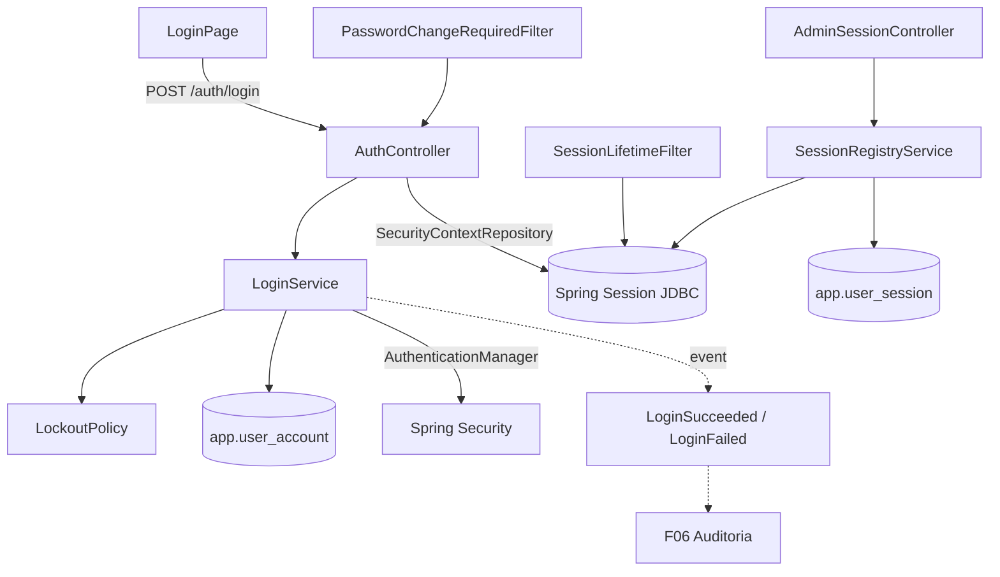

# F03 — Autenticação e Sessão Design

**Spec**: `.specs/features/F03-autenticacao/spec.md`
**Status**: Draft

---

## Architecture Overview



Login por endpoint JSON próprio (sem `formLogin`): o `AuthController` autentica via `AuthenticationManager`, chama `changeSessionId()` (proteção contra fixação) e salva o contexto com `HttpSessionSecurityContextRepository`. O Spring Session JDBC persiste a sessão em `SPRING_SESSION`, e a tabela auxiliar `app.user_session` guarda IP, user-agent e início para a tela de sessões.

---

## Code Reuse Analysis

### Existing Components to Leverage

| Component | Location | How to Use |
| --- | --- | --- |
| `UserAccount`, `UserAccountRepository`, `Argon2PasswordEncoder` | `backend/.../security/user/` (F01) | Base da autenticação; adicionar colunas |
| `SettingsStore` | `backend/.../platform/settings/` (F01) | Ler `security` e `smtp` |
| `CryptoService` | `backend/.../platform/crypto/` (F01) | Decifrar a senha SMTP |
| `ProblemDetailsHandler` | F00 | Códigos `INVALID_CREDENTIALS`, `ACCOUNT_LOCKED` etc. |
| `http.ts` | F00 | CSRF já implementado no front |

### Integration Points

| System | Integration Method |
| --- | --- |
| Spring Session JDBC | Tabelas criadas por Flyway (`V3__auth.sql`, script oficial do Spring Session para Postgres no schema `app`) |
| SMTP | `JavaMailSender` construído dinamicamente a partir do `SettingsStore` |
| F06 | `ApplicationEventPublisher` → eventos `security.auth.*` |

---

## Components

### `security.config.SecurityConfig`

- **Purpose**: `SecurityFilterChain`: rotas públicas (`/api/v1/setup/**`, `/api/v1/auth/login`, `/auth/password/forgot`, `/auth/password/reset`, `/auth/options`, `/actuator/health/**`, estáticos), CSRF por cookie, entry point 401 problem+json, access denied 403 problem+json (`CSRF_INVALID` quando a causa é CSRF).
- **Location**: `backend/src/main/java/io/databoard/security/config/SecurityConfig.java`

### `security.auth.SecurityPolicy`

- **Purpose**: Record com os parâmetros de `security` + padrões. `SecurityPolicyProvider.current()`.

### `security.auth.LockoutPolicy`

- **Purpose**: Regras de bloqueio puras.
- **Interfaces**: `boolean isLocked(UserAccount, Instant now)`, `LockoutDecision onFailure(int attempts, Instant now, SecurityPolicy)`.

### `security.auth.PasswordPolicyValidator`

- **Interfaces**: `List<FieldError> validate(String raw, SecurityPolicy)`, `boolean reused(UUID userId, String raw, int history)`.

### `security.auth.LoginService`

- **Interfaces**: `LoginResult login(String email, String password, ClientInfo)`: resolve usuário, aplica bloqueio, verifica hash, atualiza contadores com `UPDATE ... SET failed_attempts = failed_attempts + 1` atômico, calcula `passwordChangeRequired` e publica eventos.
- **Dependencies**: `Clock` injetável.

### `security.auth.AuthController`

- `POST /auth/login`, `POST /auth/logout`, `GET /auth/me`, `GET /auth/options`, `POST /auth/password/change`, `POST /auth/password/forgot`, `POST /auth/password/reset`.

### `security.session.SessionLifetimeFilter`

- **Purpose**: Invalida a sessão se `now - loginAt > sessionMaxHours`. Define `maxInactiveInterval` a partir de `sessionIdleMinutes` no login.

### `security.session.PasswordChangeRequiredFilter`

- **Purpose**: Com o atributo de sessão `PWD_CHANGE_REQUIRED`, só permite a whitelist da spec.

### `security.session.SessionRegistryService` / `AdminSessionController`

- **Interfaces**: `List<ActiveSession> listActive()` (join `app.user_session` × `SPRING_SESSION` por `session_id`), `void terminate(String sessionId)`, `void terminateAllFor(UUID userId)` (usado por bloqueio/inativação, reset e troca de senha).
- Endpoints `GET /admin/sessions`, `DELETE /admin/sessions/{id}`, `POST /admin/users/{id}/unlock`.

### `security.auth.PasswordResetService`

- **Interfaces**: `void requestReset(String email)` (sempre silencioso), `void reset(String token, String newPassword)`.

### `notification.mail.MailService`

- **Purpose**: Envio de e-mail texto/HTML simples com SMTP do `SettingsStore`.
- **Interfaces**: `boolean isConfigured()`, `void send(MailMessage)`.
- **Location**: `backend/src/main/java/io/databoard/notification/mail/MailService.java`

### Frontend — `features/auth/`

- `AuthProvider` + `useAuth()` (TanStack Query em `/auth/me`; 401 → `/login`).
- `RequireAuth` (rota protegida), `LoginPage`, `ForcedPasswordChangePage`, `ForgotPasswordPage`, `ResetPasswordPage`.
- `features/admin/sessions/SessionsPage` (tabela + ação "encerrar").

---

## Data Models

```sql
-- V3__auth.sql
ALTER TABLE app.user_account
  ADD COLUMN failed_attempts       int         NOT NULL DEFAULT 0,
  ADD COLUMN locked_until          timestamptz,
  ADD COLUMN must_change_password  boolean     NOT NULL DEFAULT false,
  ADD COLUMN password_changed_at   timestamptz NOT NULL DEFAULT now(),
  ADD COLUMN last_login_at         timestamptz;

CREATE TABLE app.password_history (
  id uuid PRIMARY KEY, user_id uuid NOT NULL REFERENCES app.user_account(id),
  password_hash varchar(200) NOT NULL, created_at timestamptz NOT NULL DEFAULT now());

CREATE TABLE app.password_reset_token (
  token_hash char(64) PRIMARY KEY, user_id uuid NOT NULL REFERENCES app.user_account(id),
  expires_at timestamptz NOT NULL, used_at timestamptz);

CREATE TABLE app.user_session (
  session_id varchar(36) PRIMARY KEY,   -- SPRING_SESSION.SESSION_ID
  user_id uuid NOT NULL REFERENCES app.user_account(id),
  ip varchar(45), user_agent varchar(500), login_at timestamptz NOT NULL);

-- + tabelas SPRING_SESSION / SPRING_SESSION_ATTRIBUTES (script oficial, schema app)
```

```ts
interface Me { id: string; name: string; email: string; roles: Role[]; permissions: string[];
               preferences: Record<string, unknown>; passwordChangeRequired: boolean }
```

---

## Error Handling Strategy

| Error Scenario | Handling | User Impact |
| --- | --- | --- |
| Credenciais inválidas / usuário inativo / e-mail inexistente | 401 `INVALID_CREDENTIALS` | "Credenciais inválidas" |
| Conta bloqueada | 423 `ACCOUNT_LOCKED` (sem informar o tempo restante) | "Conta bloqueada temporariamente" |
| Sessão expirada/encerrada | 401 `UNAUTHENTICATED` | Front redireciona ao login com aviso "Sessão encerrada" |
| CSRF ausente | 403 `CSRF_INVALID` | Front recarrega o token e repete uma vez |
| SMTP falha no reset | Log de erro, 202 | Nenhuma diferença visível |

---

## Risks & Concerns

| Concern | Location (file:line) | Impact | Mitigation |
| --- | --- | --- | --- |
| Bloqueio por conta permite DoS dirigido (bloquear a conta de alguém) | `LoginService` | Usuário legítimo bloqueado | Período curto (15 min) + desbloqueio pelo admin; rate limit por IP na V1 |
| Sem rate limit por IP | `SecurityConfig` | Força bruta distribuída por e-mails | Registrado; Argon2 encarece cada tentativa |
| Cookie `Secure` em instalação HTTP local | `application.yml` | Login quebra sem TLS | `Secure` derivado de `DATABOARD_BASE_URL` começar com `https` |
| Spring Session JDBC: limpeza de sessões expiradas | job do Spring Session | Tabela cresce | `cleanup-cron` padrão do Spring Session (a cada minuto) |

---

## Tech Decisions (only non-obvious ones)

| Decision | Choice | Rationale |
| --- | --- | --- |
| Login | Endpoint JSON próprio em vez de `formLogin` | Respostas problem+json e `passwordChangeRequired` no corpo |
| Metadados de sessão | Tabela `app.user_session` em vez de ler atributos serializados | Consulta simples para a tela de admin |
| Troca forçada | Filtro com whitelist em vez de token temporário | Mantém um único fluxo de sessão |
