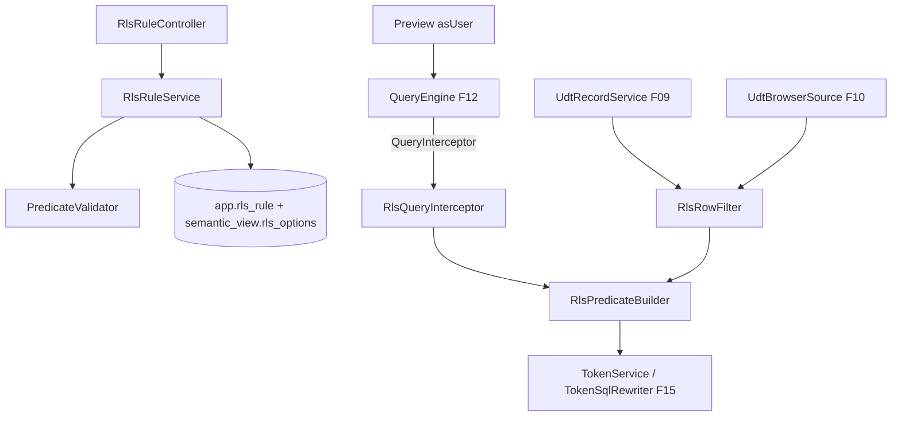

# F05 — RLS Design

**Spec**: `.specs/features/F05-rls/spec.md`
**Status**: Draft

---

## Architecture Overview



`RlsPredicateBuilder` é o núcleo único. Dado `(visão, CurrentUser)`, ele devolve um `Predicate { sql, binds }` ou `NONE`/`FALSE`. Tanto o interceptor do motor quanto o filtro de linhas da UDT usam esse mesmo builder.

---

## Code Reuse Analysis

### Existing Components to Leverage

| Component | Location | How to Use |
| --- | --- | --- |
| `QueryInterceptor` SPI | `query` (F12) | Aplicação no motor |
| `TokenService`, `TokenSqlRewriter` | `semantic.token` (F15) | Valores de tokens em binds |
| `SqlSafetyValidator` / JSqlParser | F07 | Validação do modo avançado |
| `UdtRecordService`, `UdtBrowserSource` | F09 / F10 | Pontos de aplicação diretos |
| `SystemUdtViewSync` | F12 | Achar a visão `SYSTEM_UDT` de uma UDT |
| `DependencyRegistry`, `AccessControl`, `CurrentUserProvider` | F13 / F04 | Arestas, permissão, usuário alvo |
| `AclChanged` (evento) | F04 / F06 | Auditoria |

---

## Components

### `security.rls.RlsRuleService` / `RlsRuleController`

- `list(viewId)`, `create`, `update`, `delete`; exige `MANAGE` na visão; modo avançado exige `SQL_EDITOR`; registra arestas; publica `AclChanged`.
- Endpoints: `GET|POST /views/{viewId}/rls-rules`, `PUT|DELETE /views/{viewId}/rls-rules/{ruleId}`.
- **Location**: `backend/src/main/java/io/databoard/security/rls/`

### `security.rls.PredicateValidator`

- Simples: colunas existem na visão, operador × tipo, tokens existem.
- Avançado: `unknownTokens` (F15); `SqlSafetyValidator.validateSelectOnly("SELECT 1 FROM (SELECT 1) v WHERE " + exprComTokensSubstituídosPorNull)`; identificadores sem prefixo resolvidos contra colunas da visão por análise do AST.

### `security.rls.RlsPredicateBuilder`

- `RlsDecision build(ViewDefinition view, CurrentUser user, SqlDialect dialect)`:
  1. Sem regras → `NONE`.
  2. ADMIN com `adminBypass` → `NONE`.
  3. Regras aplicáveis = alvos ∩ (user, grupos).
  4. Nenhuma aplicável → `defaultBehavior` (`NONE` ou `FALSE`).
  5. Cada regra → SQL com binds (token sem valor → `1=0`; multivalor com `EQ` → `IN`).
  6. Combina com OU entre regras e devolve um `Predicate`.
- Coluna `MISSING` usada → `RLS_COLUMN_MISSING`.

### `security.rls.RlsQueryInterceptor`

- Implementa `QueryInterceptor`: `FALSE` → predicado `1=0`.

### `security.rls.RlsRowFilter`

- `Optional<Predicate> forUdt(UUID tableId, CurrentUser)`: localiza a visão `SYSTEM_UDT` e chama o builder com nomes de coluna = `apiName` (mesmos da `udt.v_*`).
- Integração: `UdtRecordService.list/get` adicionam o predicado no `WHERE`; `patch/delete/bulk` verificam visibilidade com `SELECT 1 FROM udt.v_x v WHERE v.id = ? AND <pred>` (invisível → 404); `create` calcula `visible`.

### Preview "ver como"

- `ViewController.preview(?asUser)`: ADMIN only; monta `QueryContext` com o `CurrentUser` do alvo (`CurrentUserProvider.loadFor(userId)`) e `bypassCache=true`; publica `RlsPreviewed`.

### Frontend — `features/views/rls/`

- `RlsTab` no `ViewEditorPage`: lista de regras, `defaultBehavior`, `adminBypass`.
- `RlsRuleEditor`: alvos (usuários/grupos), modo simples (construtor de condições com grupos E/OU e valores literal | token com autocomplete) ou avançado (CodeMirror SQL + tokens).
- `PreviewAsUser`: select de usuário + grade de prévia (só ADMIN).

---

## Data Models

```sql
-- V13__rls.sql
CREATE TABLE app.rls_rule (
  id uuid PRIMARY KEY, view_id uuid NOT NULL REFERENCES app.semantic_view(id) ON DELETE CASCADE,
  name varchar(120) NOT NULL, mode varchar(8) NOT NULL CHECK (mode IN ('SIMPLE','ADVANCED')),
  predicate jsonb NOT NULL,          -- SIMPLE: árvore; ADVANCED: { sql }
  created_by uuid, created_at timestamptz NOT NULL DEFAULT now(), updated_at timestamptz NOT NULL DEFAULT now());

CREATE TABLE app.rls_rule_target (
  rule_id uuid REFERENCES app.rls_rule(id) ON DELETE CASCADE,
  principal_type varchar(5) NOT NULL, principal_id uuid NOT NULL,
  PRIMARY KEY (rule_id, principal_type, principal_id));

ALTER TABLE app.semantic_view
  ADD COLUMN rls_default_behavior varchar(10) NOT NULL DEFAULT 'DENY_ALL',
  ADD COLUMN rls_admin_bypass boolean NOT NULL DEFAULT false;
```

```json
// predicado SIMPLE
{ "logic": "OR", "items": [
  { "column": "vendedor_id", "op": "EQ", "value": { "token": "usuario.atributo.vendedor_id" } },
  { "logic": "AND", "items": [
    { "column": "filial", "op": "IN", "value": { "token": "usuario.atributo.filiais" } },
    { "column": "ativo", "op": "EQ", "value": { "literal": true } } ] } ] }
```

---

## Error Handling Strategy

| Error Scenario | Handling | User Impact |
| --- | --- | --- |
| Predicado inválido | 400 `RLS_PREDICATE_INVALID` + motivo | Erro no editor de regra |
| Coluna da regra ausente | 500→ mapeado 409 `RLS_COLUMN_MISSING` em toda consulta (falha fechada) | Objetos mostram erro até a regra ser corrigida |
| Registro invisível em escrita | 404 | "Registro não encontrado" |
| `asUser` por não-admin | 403 | Opção oculta |

---

## Risks & Concerns

| Concern | Location (file:line) | Impact | Mitigation |
| --- | --- | --- | --- |
| Caminho de leitura novo esquecer a RLS | Qualquer leitura direta de `udt.v_*`/visões | Vazamento | Regra de arquitetura: leitura de visão só via `QueryEngine`; leitura de UDT só via `UdtRecordService`/`UdtBrowserSource`; teste de arquitetura (Modulith/ArchUnit) proíbe uso direto de `DataSourceRegistry` fora de `query`, `datasource` e `udt.data` |
| Predicado avançado com subconsulta pesada | `PredicateValidator` | Lentidão | Restrito a `SQL_EDITOR`; timeout global da F02 |
| Cache compartilhado | `ResultCache` (F12) | Vazamento | T8 testa explicitamente dois usuários |

---

## Tech Decisions (only non-obvious ones)

| Decision | Choice | Rationale |
| --- | --- | --- |
| Builder único para motor e UDT | `RlsPredicateBuilder` | Uma semântica para todos os caminhos |
| Falha fechada em coluna ausente | Erro em vez de ignorar | Segurança por padrão (§0.3) |
| Escrita restrita a linhas visíveis | 404 para invisíveis | Não revela existência |
