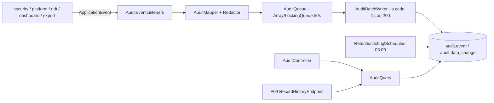

# F06 — Auditoria Design

**Spec**: `.specs/features/F06-auditoria/spec.md`
**Status**: Draft

---

## Architecture Overview



Os listeners são síncronos e baratos: só mapeiam o evento e fazem `offer` na fila. O `AuditBatchWriter` drena a fila e grava com `JdbcTemplate.batchUpdate`.

---

## Code Reuse Analysis

### Existing Components to Leverage

| Component | Location | How to Use |
| --- | --- | --- |
| Eventos `LoginSucceeded/LoginFailed/LoggedOut` | `security/auth` (F03) | Escutar |
| `SettingsChanged` | `platform/settings` (F02) | Escutar |
| Eventos de usuário/grupo/ACL | `security` (F04): adicionar `AclChanged`, `UserChanged`, `GroupChanged` se ainda não existirem | Escutar |
| `SettingsStore` / `GeneralSettings` | F01/F02 | `retentionDays` (adicionar campo `auditRetentionDays` ao `GeneralSettings`, padrão 365) |
| `PageResponse` | F00 | Consulta paginada |

### Integration Points

| System | Integration Method |
| --- | --- |
| Futuras features | Publicam `ScreenOpened` (F19), `UdtRecordChanged` (F09), `DataExported` (F29); classes de evento definidas aqui em `audit.api` |
| Micrometer | Contadores `audit.write.failures`, `audit.dropped`; gauge `audit.queue.size` |

---

## Components

### `audit.api.*` (eventos públicos)

- `ScreenOpened(userId, screenId)`, `UdtRecordChanged(userId, tableId, recordId, op, Map<String,Object> before, Map<String,Object> after)`, `DataExported(userId, resourceType, resourceId, format, rows)`.
- **Location**: `backend/src/main/java/io/databoard/audit/api/`

### `audit.internal.Redactor`

- **Interfaces**: `JsonNode redact(JsonNode)`: substitui recursivamente chaves sensíveis; trunca > 64 KB.

### `audit.internal.AuditMapper`

- **Interfaces**: `AuditRecord map(Object event)` e `List<DataChangeRecord> diff(UdtRecordChanged)`: só campos com valor diferente.

### `audit.internal.AuditQueue` / `AuditBatchWriter`

- Fila limitada; `offer` não bloqueante; writer `@Scheduled(fixedDelay=1000)` + disparo quando size ≥ 200; `@PreDestroy` drena por até 10 s.

### `audit.internal.RetentionJob`

- `@Scheduled(cron = "0 0 3 * * *", zone = <fuso da instância>)`; `SET LOCAL databoard.audit_retention='on'`; `DELETE ... WHERE occurred_at < now() - interval`.

### `audit.AuditQuery` (interface pública)

- `Page<AuditEventView> search(AuditFilter, Pageable)`, `List<DataChangeView> recordHistory(UUID tableId, UUID recordId)`.

### `audit.internal.AuditController`

- `GET /api/v1/audit/events` (ADMIN).

### Frontend — `features/admin/audit/AuditPage`

- Filtros (período com atalhos, usuário, categoria/tipo, recurso) + grade com linha expansível para `details`.

---

## Data Models

```sql
-- V6__audit.sql
CREATE TABLE audit.event (
  id bigserial PRIMARY KEY,
  occurred_at timestamptz NOT NULL,
  user_id uuid, actor_label varchar(320),
  category varchar(20) NOT NULL,       -- AUTH | ACCESS | SECURITY | EXPORT | DATA | SYSTEM
  type varchar(60) NOT NULL,
  resource_type varchar(20), resource_id uuid,
  ip varchar(45), user_agent varchar(500),
  details jsonb NOT NULL DEFAULT '{}');
CREATE INDEX ix_audit_event_time ON audit.event (occurred_at DESC);
CREATE INDEX ix_audit_event_user ON audit.event (user_id, occurred_at DESC);
CREATE INDEX ix_audit_event_res  ON audit.event (resource_type, resource_id, occurred_at DESC);

CREATE TABLE audit.data_change (
  id bigserial PRIMARY KEY,
  occurred_at timestamptz NOT NULL, user_id uuid,
  table_id uuid NOT NULL, record_id uuid NOT NULL,
  operation varchar(6) NOT NULL, field varchar(80) NOT NULL,
  old_value jsonb, new_value jsonb);
CREATE INDEX ix_data_change_record ON audit.data_change (table_id, record_id, occurred_at DESC);

CREATE FUNCTION audit.forbid_mutation() RETURNS trigger AS $$
BEGIN
  IF current_setting('databoard.audit_retention', true) = 'on' AND TG_OP = 'DELETE' THEN
    RETURN OLD;
  END IF;
  RAISE EXCEPTION 'audit is append-only';
END $$ LANGUAGE plpgsql;
CREATE TRIGGER t_event_ro BEFORE UPDATE OR DELETE ON audit.event
  FOR EACH ROW EXECUTE FUNCTION audit.forbid_mutation();
CREATE TRIGGER t_data_change_ro BEFORE UPDATE OR DELETE ON audit.data_change
  FOR EACH ROW EXECUTE FUNCTION audit.forbid_mutation();
```

---

## Error Handling Strategy

| Error Scenario | Handling | User Impact |
| --- | --- | --- |
| Falha no batch insert | Log de erro + `audit.write.failures`; lote descartado após 3 tentativas | Nenhum |
| Fila cheia | Descarta, `audit.dropped`, log limitado a 1/min | Nenhum |
| Tentativa de mutação | Exceção do trigger | Só ocorre por bug; aparece no log |

---

## Risks & Concerns

| Concern | Location (file:line) | Impact | Mitigation |
| --- | --- | --- | --- |
| Perda de eventos em crash (até 1 s ou 200 eventos) | `AuditBatchWriter` | Lacuna de auditoria | Aceito pelo RN-06.3; drenagem no shutdown gracioso |
| `DELETE` de retenção grande trava a tabela | `RetentionJob` | Lentidão às 03:00 | Apagar em lotes de 10.000 com `ctid IN (SELECT ... LIMIT)` |
| Histórico de UDT depende de o F09 publicar o evento em toda escrita | `udt` (F09) | Histórico incompleto | RN-09.6 (toda escrita passa pelo serviço) + teste de contrato na F09 |

---

## Tech Decisions (only non-obvious ones)

| Decision | Choice | Rationale |
| --- | --- | --- |
| Fila própria em vez de `@Async` / `@TransactionalEventListener` do Modulith com outbox | `ArrayBlockingQueue` + batch | RN-06.3 pede batch; outbox seria síncrono no banco e mais caro |
| Append-only no banco | Trigger com bypass por `SET LOCAL` | Garante RN-06.1 mesmo contra bugs da aplicação |
