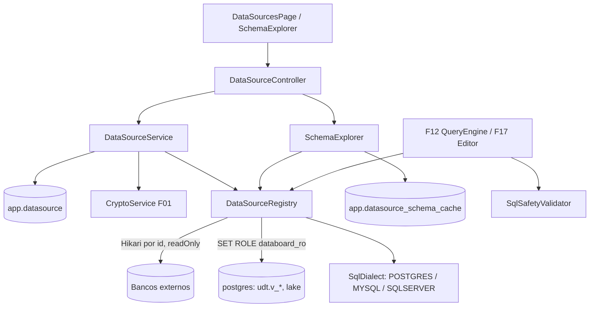

# F07 — Conexões de Dados Design

**Spec**: `.specs/features/F07-conexoes/spec.md`
**Status**: Draft

---

## Architecture Overview



---

## Code Reuse Analysis

### Existing Components to Leverage

| Component | Location | How to Use |
| --- | --- | --- |
| `CryptoService` | `platform/crypto` (F01) | Senha |
| `AccessControl` + `registerResource` | F04 | Recurso `DATASOURCE` |
| `DependencyRegistry` | F13 | `DATASOURCE_IN_USE` |
| `ReadViewGenerator` | `udt/schema` (F09) | Passa a executar `GRANT SELECT ON udt.v_<id> TO databoard_ro` após cada `CREATE VIEW` |
| `AclEditor` | `shared/acl` (F04) | Compartilhar a conexão |

### Integration Points

| System | Integration Method |
| --- | --- |
| F12/F17 | `DataSourceRegistry.jdbc(id)` → `JdbcTemplate` com timeout; `SqlDialect` para paginação e quoting |
| F08 (V1) | `DataSourceRegistry` para leitura em lote (`fetchSize`) |

---

## Components

### `datasource.dialect.SqlDialect` (interface pública; AD-010)

- **Purpose**: Diferenças por banco, reutilizadas pelo motor de consulta (F12).
- **Interfaces**: `String jdbcUrl(DataSourceDefinition)`, `Set<String> allowedExtraParams()`, `String versionQuery()`, `String quote(String identifier)`, `String limitOffset(String sql, int limit, int offset)`, `String dateTrunc(String expr, DateGrain grain)`, `String driverClass()`.
- Implementações: `PostgresDialect`, `MySqlDialect` (também MariaDB), `SqlServerDialect`.
- **Location**: `backend/src/main/java/io/databoard/datasource/dialect/`

### `datasource.DataSourceRegistry` (interface pública)

- `JdbcTemplate jdbc(UUID datasourceId)`, `SqlDialect dialect(UUID)`, `void evict(UUID)`.
- Pools Hikari criados sob demanda (`readOnly=true`, `maximumPoolSize`, `connectionTimeout=5s`, `idleTimeout`), fechados após 15 min sem uso por um `@Scheduled` de manutenção.
- Conexão interna: pool sobre o datasource principal com `connectionInitSql = "SET ROLE databoard_ro; SET default_transaction_read_only = on"`.

### `datasource.SqlSafetyValidator` (interface pública)

- `void validateSelectOnly(String sql)`: JSqlParser `CCJSqlParserUtil.parseStatements`; exatamente 1 `Select`; percorre `PlainSelect` rejeitando `INTO` e `FOR UPDATE`.

### `datasource.ConnectionTester`

- `TestResult test(DataSourceDefinition)`: `DriverManager` com `loginTimeout=5`, mede latência, executa `versionQuery`, classifica a exceção (SQLState `28*` → `AUTH_FAILED`, `08*` → `HOST_UNREACHABLE`, timeout → `TIMEOUT`).

### `datasource.SchemaExplorer`

- `SchemaTree get(UUID id, boolean refresh)`: `DatabaseMetaData.getSchemas/getTables/getColumns`; limite de 5.000 tabelas; para a interna, filtra `udt.v_*` (rótulo vindo de `udt_table`) e `lake`.

### `datasource.DataSourceService` / `DataSourceController`

- CRUD com máscara e preservação de senha, whitelist de parâmetros, `evict` no update, checagem de dependentes no delete, proteção da conexão interna.

### Migração do role somente leitura

- `V11__datasource.sql`: tabelas + bloco `DO $$ ... CREATE ROLE databoard_ro NOLOGIN ... $$` condicional, `GRANT databoard_ro TO current_user`, `GRANT USAGE ON SCHEMA udt, lake TO databoard_ro`, `ALTER DEFAULT PRIVILEGES IN SCHEMA lake GRANT SELECT ON TABLES TO databoard_ro`. As views `udt.v_*` recebem `GRANT` explícito do `ReadViewGenerator`.

### Frontend — `features/admin/datasources/`

- `DataSourcesPage` (lista com tipo, modo, status do último teste).
- `DataSourceForm` (campos por tipo, parâmetros extras chave/valor, botão "Testar conexão" com resultado inline).
- `shared/schema/SchemaExplorer` (árvore schema → tabela → colunas com tipo; botão "Atualizar metadados"; reutilizado na F17 e no editor de visões).

---

## Data Models

```sql
-- V11__datasource.sql
CREATE TABLE app.datasource (
  id uuid PRIMARY KEY, name varchar(120) NOT NULL UNIQUE,
  type varchar(12) NOT NULL CHECK (type IN ('POSTGRES','MYSQL','SQLSERVER','INTERNAL')),
  host varchar(255), port int, database_name varchar(128), username varchar(128),
  password_enc text, extra_params jsonb NOT NULL DEFAULT '{}', ssl boolean NOT NULL DEFAULT false,
  source_timezone varchar(64) NOT NULL DEFAULT 'UTC', pool_max int NOT NULL DEFAULT 5,
  mode varchar(10) NOT NULL DEFAULT 'LIVE' CHECK (mode IN ('LIVE','ETL_ONLY')),
  created_by uuid, created_at timestamptz NOT NULL DEFAULT now(), updated_at timestamptz NOT NULL DEFAULT now());

INSERT INTO app.datasource (id, name, type, mode)
VALUES ('00000000-0000-0000-0000-000000000001', 'internal', 'INTERNAL', 'LIVE');

CREATE TABLE app.datasource_schema_cache (
  datasource_id uuid PRIMARY KEY REFERENCES app.datasource(id) ON DELETE CASCADE,
  payload jsonb NOT NULL, refreshed_at timestamptz NOT NULL);
```

---

## Error Handling Strategy

| Error Scenario | Handling | User Impact |
| --- | --- | --- |
| Teste falha | 200 `{ success:false, errorCode, message }` | Alerta vermelho com a causa |
| Parâmetro fora da whitelist | 400 em `extraParams.<k>` | Erro no campo |
| Exclusão em uso | 409 `DATASOURCE_IN_USE` + dependentes | `DependentsModal` |
| SQL não-SELECT | 400 `ONLY_SELECT_ALLOWED` | Mensagem no editor de visão/SQL |
| Origem fora do ar em uso | 502 `DATASOURCE_UNAVAILABLE` (F12 trata por objeto) | Objeto mostra erro sem quebrar a tela |
| Conexão interna alterada | 409 `INTERNAL_DATASOURCE_READONLY` | Botões ocultos |

---

## Risks & Concerns

| Concern | Location (file:line) | Impact | Mitigation |
| --- | --- | --- | --- |
| Usuário do Postgres da plataforma sem `CREATEROLE` em instalações próprias | `V11__datasource.sql` | Migração falha | Bloco condicional; mensagem clara; compose oficial usa o superusuário do container |
| Imagem SQL Server para testes é grande e não roda em arm64 | Testes de integração | CI lenta / Macs ARM | Testes MSSQL com tag `mssql`, rodando só em CI amd64 |
| Parser JSqlParser não cobre todos os dialetos | `SqlSafetyValidator` | Falso positivo em SQL válido | Rejeitar em caso de dúvida (seguro); mensagem pedindo SQL padrão; conexão já é `readOnly` como segunda barreira |
| Pools ociosos acumulam conexões no ERP | `DataSourceRegistry` | Consumo de conexões | Fechar após 15 min ociosos; `minimumIdle=0` |

---

## Tech Decisions (only non-obvious ones)

| Decision | Choice | Rationale |
| --- | --- | --- |
| Somente leitura da interna por role do Postgres | `SET ROLE databoard_ro` | Garantia no banco, não só no parser |
| `SqlDialect` mora em `datasource` | Interface pública reaproveitada pela F12 | Dialeto é propriedade da conexão |
| Teste devolve 200 com `success=false` | Em vez de 4xx | Falha de teste é resultado esperado, não erro da API |
