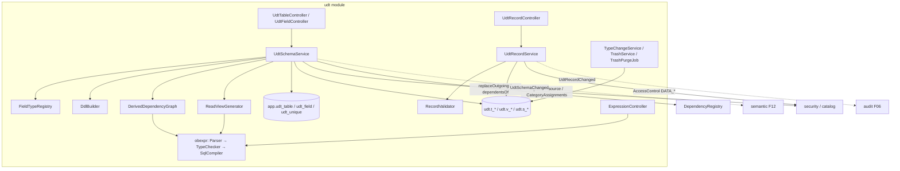

# F09 — Tabelas Personalizadas Design

**Spec**: `.specs/features/F09-tabelas-personalizadas/spec.md`
**Status**: Draft

---

## Architecture Overview



### Abordagem escolhida

Esta é a decisão D-02, já tomada em AD-006, com o compilador da AD-007. As alternativas (JSONB e EAV) foram avaliadas e descartadas no produto (§9.9). O design detalha só a abordagem escolhida.

### Geração das views (núcleo)

Para cada tabela `T`, `udt.v_<T>` é:

```sql
CREATE VIEW udt.v_<T> AS
SELECT t.id, t.version, t.created_at, t.updated_at, t.created_by, t.updated_by,
       t.f_a1 AS quantidade, t.f_a2 AS preco_unitario,           -- armazenados
       r1.f_c9 AS cliente_nome,                                   -- LOOKUP via LEFT JOIN
       (t.f_a1 * t.f_a2) AS valor_total,                          -- FORMULA compilada
       ru1.v AS total_itens                                       -- ROLLUP via LATERAL
FROM udt.t_<T> t
LEFT JOIN udt.v_<C> r1 ON r1.id = t.f_ref1
LEFT JOIN LATERAL (SELECT SUM(c.total) AS v FROM udt.v_<I> c
                   WHERE c.<fk_apiName> = t.id AND (c.cancelado = false)) ru1 ON true;
```

- Lookups e navegação fazem join na **view** da tabela alvo, para enxergar derivados dela (RF-09.10).
- Uma FORMULA que usa outra FORMULA da mesma tabela tem a expressão expandida inline em ordem topológica. Não há referência a alias da mesma view.
- **Regeneração:** dada a tabela alterada, o `ReadViewGenerator` calcula o fecho das views dependentes (grafo `app.dependency` com arestas `UDT_TABLE→UDT_TABLE`) e, numa transação, faz `DROP VIEW IF EXISTS` em ordem topológica reversa e `CREATE VIEW` em ordem topológica. O DDL transacional do Postgres garante que leitores nunca vejam estado intermediário (bloqueio curto de `AccessExclusiveLock`).

---

## Code Reuse Analysis

### Existing Components to Leverage

| Component | Location | How to Use |
| --- | --- | --- |
| `AccessControl`, `@RequiresFlag(MANAGE_UDT_SCHEMA)` | `security/access` (F04) | Estrutura e dados |
| `CategoryAssignments` | `catalog/category` (F13) | Categoria da tabela |
| `DependencyRegistry` | `platform/dependency` (F13) | Arestas `UDT_FIELD→UDT_FIELD`, `UDT_TABLE→UDT_TABLE`; checagem de exclusão |
| `UdtRecordChanged`, `AuditQuery.recordHistory` | `audit` (F06) | Histórico de dados |
| `LimitsProvider` | `platform/settings` (F02) | Limites RN-09.5 (adicionar `udtMaxFields`, `udtMaxNavigationDepth`, `udtMaxRollups`) |
| Job runner `@Scheduled` + `app.job_run` | AD-015 (criar `platform.jobs.JobRunRecorder` nesta feature se ainda não existir) | Limpeza da lixeira |

### Integration Points

| System | Integration Method |
| --- | --- |
| F10 Browser | Usa os endpoints de records e reference-options |
| F11 Importação | Usa `UdtRecordService.bulk` e `UdtSchemaService.createTable` |
| F12 Visões | Escuta `UdtSchemaChanged`; lê `udt.v_*`; reusa `obexpr` para colunas calculadas |
| F17 Editor SQL | Consulta `udt.v_*` (somente leitura) |

---

## Components

### `udt.obexpr` (subpacote; API pública reutilizada pela F12)

- **Grammar**: `backend/src/main/antlr4/io/databoard/udt/obexpr/OBExpr.g4` (plugin `antlr4-maven-plugin`).
- `ObExprParser.parse(String) → Expr` (AST imutável com `start/end`); erros de sintaxe → `ObExprError(message, start, end)` via `BaseErrorListener`.
- `TypeChecker.check(Expr, FieldScope) → ExprType` com `FunctionCatalog` (aridade, tipos de argumento, tipo de retorno).
- `SqlCompiler.compile(Expr, FieldScope, Mode) → CompiledSql { String sql; List<Object> binds; Set<FieldRef> usedFields; Set<JoinPath> joins }`.
  - `Mode.INLINE`: literais embutidos (texto com `'` duplicado; números validados com `BigDecimal`; datas como `DATE 'yyyy-mm-dd'`).
  - `Mode.BIND`: literais viram `?`.
  - Divisão compilada como `a / NULLIF(b, 0)`; `&` como `concat(a, b)`; `DATEDIFF(a,b,'day')` como `(a::date - b::date)`.
- `FieldScope`: resolve `{campo}` e `{ref.campo}` para expressões SQL com alias de join, até `maxDepth`.

### `udt.schema.FieldTypeRegistry`

- **Purpose**: Por tipo, define `pgType(config)`, validação do `config` e se é armazenado/derivado.
- **Interfaces**: `FieldTypeSpec spec(FieldType)`; `List<FieldError> validateConfig(FieldType, JsonNode)`.

### `udt.schema.DdlBuilder`

- **Purpose**: Gera DDL a partir de metadados (nunca de input bruto).
- **Interfaces**: `createTable(shortId)`, `addColumn(table, field)`, `dropColumn`, `addForeignKey(field, onDelete)`, `createUniqueIndex(table, fields)`, `createSequence(field)`, `setDefault(field, compiledSql)`, `alterType(field, newPgType, usingSql)`.

### `udt.schema.ApiNameGenerator`

- `String generate(String label, Set<String> taken)`: normaliza NFD, remove acentos, `snake_case`, trata reservados e colisões.

### `udt.schema.UdtSchemaService`

- `createTable`, `updateTable`, `addField`, `updateField`, `reorderFields`, `addUniqueConstraint`, `duplicateTable`.
- Fluxo de `addField`/`updateField`: lock da tabela (`FOR UPDATE`) → validação de tipo/config/limites → para derivados: compilar, `DerivedDependencyGraph.assertAcyclic` → metadado → DDL → `DependencyRegistry.replaceOutgoing` → `ReadViewGenerator.regenerate(tableId)` → `UdtSchemaChanged` (`@TransactionalEventListener(AFTER_COMMIT)` no consumidor).

### `udt.schema.DerivedDependencyGraph`

- `void assertAcyclic(FieldRef changed, Set<FieldRef> uses)`: DFS sobre arestas `UDT_FIELD` do registro + as novas; lança `UDT_CIRCULAR_DEPENDENCY` com o caminho em rótulos.

### `udt.schema.ReadViewGenerator`

- `void regenerate(UUID tableId)`: fecho de dependentes → drop/create em ordem topológica.
- `String buildViewSql(TableMeta)`: puro (testável por snapshot).

### `udt.data.RecordValidator`

- `List<FieldError> validate(TableMeta, Map<String,Object> values, Mode INSERT|PATCH)`: tipo, obrigatório (só em INSERT ou quando enviado `null`), min/max, regex, formatos, opções, `READ_ONLY_FIELD`.

### `udt.data.UdtRecordService`

- `create`, `patch(version)`, `delete`, `bulk`, `get`, `list(filter, sort, page, fields)`.
- SQL de escrita com `NamedParameterJdbcTemplate` sobre colunas `f_*` do metadado.
- Violações: `23505` (unique) → `UNIQUE_VIOLATION` mapeando o índice para campos; `23503` (FK) → `UDT_RECORD_REFERENCED`.
- Publica `UdtRecordChanged` (lendo o `before` com `SELECT ... FOR UPDATE`).

### `udt.lifecycle.TypeChangeService`

- `simulate(fieldId, newType)` com `pg_input_is_valid`; `convert(fieldId, newType)` com `USING CASE WHEN pg_input_is_valid(...) THEN ... ELSE NULL END`.

### `udt.lifecycle.TrashService` / `TrashPurgeJob`

- `deleteField/deleteTable` (checagem `dependentsOf` → 409), `restore`, `listTrash`; job diário 02:30 faz o drop físico após 30 dias.

### Controllers

- `UdtTableController` (`/udt/tables`, `/duplicate`, `/dependencies`), `UdtFieldController` (`/fields`, `/type-change/simulate`, `/type-change/apply`), `UdtRecordController` (`/records`, `/bulk`, `/history`, `/reference-options`), `ExpressionController` (`/udt/expressions/validate`), `TrashController` (`/udt/trash`).

### Frontend — `features/udt/`

- `UdtListPage` (lista com categoria), `TableDesignerPage` (lista de campos com arrastar para reordenar, unicidades, campo de exibição, opção "só edita os próprios"), `FieldEditorDrawer` (formulário dinâmico por tipo), `ReferenceFieldForm`, `LookupFieldForm`, `RollupFieldForm`, `FormulaEditor` (CodeMirror 6: autocomplete de `{campos}` e funções, sublinhado de erro por `start/end`, prévia de 5 linhas, debounce de 300 ms), `TypeChangeDialog`, `DependentsModal` (409), `UdtTrashPage`.

---

## Data Models

```sql
-- V8__udt.sql
CREATE TABLE app.udt_table (
  id uuid PRIMARY KEY, short_id char(8) NOT NULL UNIQUE,
  label varchar(120) NOT NULL, description text, icon varchar(40),
  display_field_id uuid, own_records_only boolean NOT NULL DEFAULT false,
  created_by uuid NOT NULL, created_at timestamptz NOT NULL DEFAULT now(),
  updated_at timestamptz NOT NULL DEFAULT now(), deleted_at timestamptz);

CREATE TABLE app.udt_field (
  id uuid PRIMARY KEY, table_id uuid NOT NULL REFERENCES app.udt_table(id),
  short_id char(8) NOT NULL UNIQUE, label varchar(120) NOT NULL,
  api_name varchar(63) NOT NULL, type varchar(20) NOT NULL, position int NOT NULL,
  required boolean NOT NULL DEFAULT false, is_unique boolean NOT NULL DEFAULT false,
  config jsonb NOT NULL DEFAULT '{}', description text,
  created_at timestamptz NOT NULL DEFAULT now(), deleted_at timestamptz);
CREATE UNIQUE INDEX ux_udt_field_api ON app.udt_field (table_id, api_name) WHERE deleted_at IS NULL;

CREATE TABLE app.udt_unique (
  id uuid PRIMARY KEY, table_id uuid NOT NULL REFERENCES app.udt_table(id),
  field_ids uuid[] NOT NULL, index_name varchar(63) NOT NULL);
```

```java
enum FieldType { TEXT, LONG_TEXT, INTEGER, DECIMAL, CURRENCY, PERCENT, BOOLEAN, DATE, DATETIME,
  SELECT, MULTI_SELECT, EMAIL, URL, PHONE, AUTONUMBER, REFERENCE, LOOKUP, FORMULA, ROLLUP }
// config por tipo (JSON), ex.:
// REFERENCE: { target:{kind:"UDT",tableId}, cardinality:"MANY_TO_ONE", onDelete:"RESTRICT", inverseLabel }
// LOOKUP:    { referenceFieldId, targetFieldId }
// FORMULA:   { expression, resultType?, maskId? }
// ROLLUP:    { inverseOf: referenceFieldId, function:"SUM", fieldId?, filter? }
// AUTONUMBER:{ prefix?, padding? }    SELECT/MULTI_SELECT: { options:[{value,label,color}] }
```

| Tipo | Postgres |
| --- | --- |
| TEXT, EMAIL, URL, PHONE | `varchar(maxLength ?? 500)` |
| LONG_TEXT | `text` |
| INTEGER, AUTONUMBER | `bigint` |
| DECIMAL | `numeric(18, casas)` |
| CURRENCY | `numeric(18,2)` |
| PERCENT | `numeric(12,6)` |
| BOOLEAN | `boolean` |
| DATE / DATETIME | `date` / `timestamptz` |
| SELECT / MULTI_SELECT | `varchar(100)` / `text[]` |
| REFERENCE | `uuid` + FK + índice |

---

## Error Handling Strategy

| Error Scenario | Handling | User Impact |
| --- | --- | --- |
| DDL falha | Rollback total; 500 `UDT_DDL_FAILED`, SQL logado | "Não foi possível alterar a estrutura" |
| Ciclo | 422 `UDT_CIRCULAR_DEPENDENCY` + `path` | Editor mostra o caminho |
| Dependentes na exclusão | 409 `UDT_FIELD_IN_USE`/`UDT_TABLE_IN_USE` + `dependents[]` | `DependentsModal` |
| Validação de dados | 400 `VALIDATION_ERROR` + `errors[]` | Erros inline (F10) |
| Conflito de versão | 409 `RECORD_VERSION_CONFLICT` + registro atual | F10 oferece recarregar/sobrescrever |
| Registro referenciado | 409 `UDT_RECORD_REFERENCED` | Mensagem com a tabela que referencia |
| Limites | 422 `UDT_LIMIT_*` | Aviso no designer |

---

## Risks & Concerns

| Concern | Location (file:line) | Impact | Mitigation |
| --- | --- | --- | --- |
| Regenerar views em cascata pega `AccessExclusiveLock` e bloqueia leituras | `ReadViewGenerator` | Pausa curta em telas durante mudanças de estrutura | Transação curta; `lock_timeout = 5s` com erro amigável `UDT_SCHEMA_BUSY`; mudanças de estrutura são raras |
| Rollups `LATERAL` sobre tabelas grandes ficam lentos | `ReadViewGenerator` | Telas lentas | Índice automático na FK; materialização na V1 (§9.9) |
| Injeção via literal de fórmula no modo DDL | `SqlCompiler` INLINE | SQL injection em DDL | Escape único centralizado + teste com payloads (`'); DROP TABLE x;--`) + identificadores só do metadado |
| ANTLR + Java 25 / Maven | `pom.xml` | Build quebra | Fixar versão do plugin na T13; fallback: gerar o parser e versioná-lo |
| `pg_input_is_valid` exige Postgres ≥ 16 | `TypeChangeService` | Falha em Postgres antigo | Compose fixa `postgres:17`; documentar requisito |

---

## Tech Decisions (only non-obvious ones)

| Decision | Choice | Rationale |
| --- | --- | --- |
| Colunas da view com `apiName` | Em vez de `f_<id>` | SQL legível (F17); RN-09.4 já protege renomeações com dependentes |
| Lookups via view alvo | Join em `udt.v_*`, não em `udt.t_*` | Permite lookup de campo derivado (RF-09.10) |
| FORMULA intra-tabela expandida inline | Sem CTE/subview | View única por tabela, simples de regenerar |
| Editor de fórmula | CodeMirror 6 (também na F17) | Mais leve que o Monaco; autocomplete e lint por posição nativos (registrado como decisão de feature, reutilizado na F17) |
