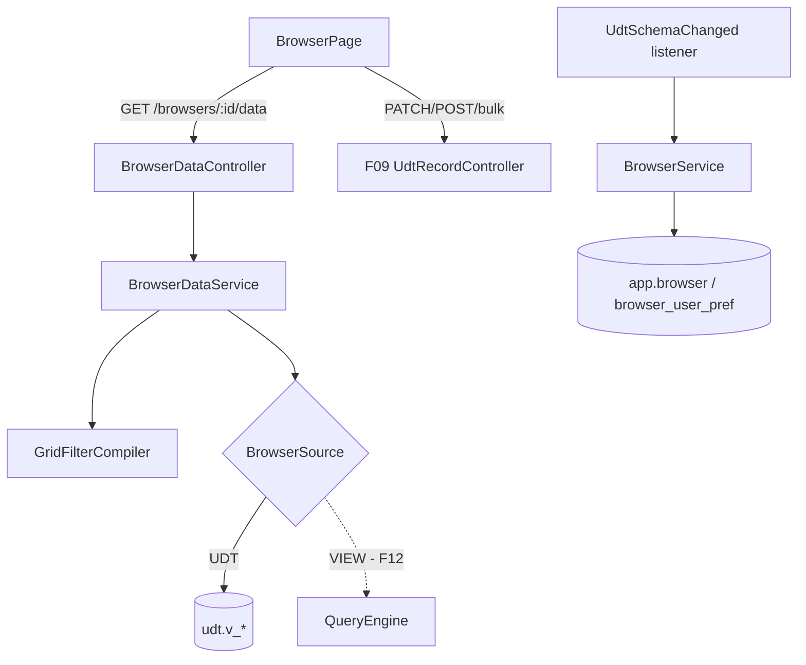

# F10 — Browser Design

**Spec**: `.specs/features/F10-browser/spec.md`
**Status**: Draft

---

## Architecture Overview



A escrita reaproveita integralmente os endpoints de registros da F09. O Browser só adiciona leitura configurada (colunas, filtros padrão) e preferências.

---

## Code Reuse Analysis

### Existing Components to Leverage

| Component | Location | How to Use |
| --- | --- | --- |
| Endpoints de records, bulk, history, reference-options | `udt/data` (F09) | Toda escrita e o histórico |
| Metadados de UDT (`TableMeta`) | `udt/schema` (F09) | Colunas, tipos, identificadores físicos |
| `UdtSchemaChanged` | F09 | Criar Browser padrão e limpar colunas removidas |
| `AccessControl` | F04 | `BROWSER` (VIEW/EDIT/MANAGE) + `DATA_*` na UDT |
| `formatValue` | F13/F14 | Exibição das células |
| `DependentsModal` | F09 | Erros 409 |

### Integration Points

| System | Integration Method |
| --- | --- |
| F12 | Implementa `BrowserSource` para `VIEW` (somente leitura) |
| F29 | Botão "Exportar" reusa `BrowserDataService.query(...)` sem paginação |
| F30 | Itens de menu do tipo `BROWSER` |

---

## Components

### `udt.browser.BrowserService` / `BrowserController`

- CRUD de `/api/v1/browsers`; registro do recurso `BROWSER` com o pai = UDT de origem (herda a ACL da tabela quando não há entradas próprias).
- `onSchemaChanged(tableId)`: cria o padrão se não existe; remove colunas excluídas das configurações.
- **Location**: `backend/src/main/java/io/databoard/udt/browser/`

### `udt.browser.GridFilterCompiler`

- **Interfaces**: `CompiledWhere compile(List<GridFilter>, String q, TableMeta)`: valida coluna/operador por tipo e produz SQL com binds.

### `udt.browser.BrowserDataService` / `BrowserDataController`

- `PageResponse<Map<String,Object>> data(browserId, page, size, sort, filters, q)`, mais `meta` (colunas com tipo, `readOnly`, `maskId`, permissões efetivas do usuário: `canInsert`, `canUpdate`, `canDelete`).
- `BrowserSource` (interface): `UdtBrowserSource` aqui; `ViewBrowserSource` na F12.

### `udt.browser.BrowserPreferenceController`

- `PUT /api/v1/browsers/{id}/preferences` `{ hiddenColumns, widths, frozenColumns }`.

### Frontend — `features/browser/`

- `BrowserPage`: TanStack Table (modo manual de paginação, ordenação e filtros) + `@tanstack/react-virtual` para linhas.
- `cells/` editores por tipo: `TextCell`, `NumberCell`, `DateCell`, `BooleanCell`, `SelectCell`, `MultiSelectCell`, `ReferenceCell` (combo assíncrono).
- `ColumnFilterPopover` por tipo; `GlobalSearch`.
- `RecordFormDrawer` (seções + abas "Dados" | "Histórico" + `InverseRelationGrid` por relação).
- `BulkActionsBar` (excluir, alterar campo).
- `ConflictDialog`.
- `BrowserConfigDrawer` (colunas, ordem, filtros padrão, tamanho de página, seções do formulário).
- `useBrowserData` (TanStack Query com `keepPreviousData`).

---

## Data Models

```sql
-- V9__browser.sql
CREATE TABLE app.browser (
  id uuid PRIMARY KEY, name varchar(120) NOT NULL,
  source_type varchar(10) NOT NULL CHECK (source_type IN ('UDT','VIEW')),
  source_id uuid NOT NULL, is_default boolean NOT NULL DEFAULT false,
  config jsonb NOT NULL,            -- columns[], sort[], defaultFilters[], pageSize, formSections[]
  created_by uuid NOT NULL, created_at timestamptz NOT NULL DEFAULT now(),
  updated_at timestamptz NOT NULL DEFAULT now());
CREATE UNIQUE INDEX ux_browser_default ON app.browser (source_type, source_id) WHERE is_default;

CREATE TABLE app.browser_user_pref (
  browser_id uuid REFERENCES app.browser(id) ON DELETE CASCADE,
  user_id uuid NOT NULL, prefs jsonb NOT NULL,
  PRIMARY KEY (browser_id, user_id));
```

```ts
interface BrowserConfig {
  columns: { fieldApiName: string; width?: number }[];
  sort: { column: string; direction: 'asc' | 'desc' }[];
  defaultFilters: GridFilter[];
  pageSize: number;
  formSections: { title: string; fields: string[] }[];
}
interface GridFilter { column: string; op: FilterOp; value?: unknown }
```

---

## Error Handling Strategy

| Error Scenario | Handling | User Impact |
| --- | --- | --- |
| Filtro inválido | 400 `INVALID_FILTER` + índice | Filtro marcado em vermelho |
| Sem `DATA_READ` | 403 | Tela "Sem acesso" |
| Validação de célula | 400 `VALIDATION_ERROR` (F09) | Tooltip de erro na célula; valor editado mantido |
| Conflito | 409 `RECORD_VERSION_CONFLICT` | `ConflictDialog` |
| Fonte na lixeira | 410 `SOURCE_DELETED` | Aviso com link para a lixeira (se tiver permissão) |

---

## Risks & Concerns

| Concern | Location (file:line) | Impact | Mitigation |
| --- | --- | --- | --- |
| Busca global com `ILIKE '%q%'` sem índice em tabelas grandes | `GridFilterCompiler` | Lentidão | Limitar `q` a ≥ 2 caracteres; extensão `pg_trgm` com índice GIN opcional (V1) |
| Rollups pesados na view deixam a grade lenta | `udt.v_*` (F09) | Paginação lenta | `COUNT(*)` separado com `LIMIT` sobre a tabela base sem joins; materialização na V1 |
| Edição inline com muitos PATCH simultâneos | `BrowserPage` | Conflitos de versão do próprio usuário | Fila de salvamento por linha no front (um PATCH por vez por registro) |

---

## Tech Decisions (only non-obvious ones)

| Decision | Choice | Rationale |
| --- | --- | --- |
| Browser pertence ao módulo `udt` | Pacote `udt.browser` | A fonte principal é UDT; a fonte VIEW entra por interface |
| ACL do Browser herda da UDT | Pai do recurso = UDT | Zero configuração no caso comum |
| Contagem total | Consulta separada sobre `udt.t_*` com os mesmos filtros quando eles só usam colunas armazenadas | Evita calcular rollups só para contar |
