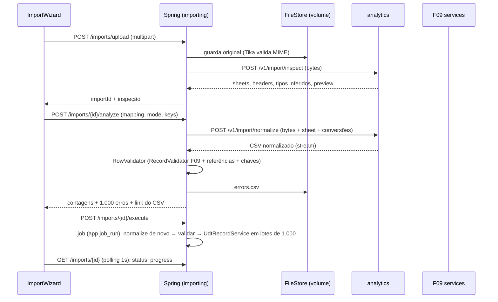

# F11 — Importação e Upload Design

**Spec**: `.specs/features/F11-importacao/spec.md`
**Status**: Draft

---

## Architecture Overview



O `analyze` grava o resultado normalizado (CSV no FileStore) para que o `execute` não precise chamar o analytics de novo. O `execute` reaproveita o arquivo normalizado e revalida, porque os dados alvo podem ter mudado entre as duas chamadas.

---

## Code Reuse Analysis

### Existing Components to Leverage

| Component | Location | How to Use |
| --- | --- | --- |
| `UdtSchemaService.createTable/addField` | `udt/schema` (F09) | Destino "nova tabela" e tipos FILE/IMAGE |
| `RecordValidator`, `UdtRecordService` (escrita em lote interna) | `udt/data` (F09) | Validação e gravação com auditoria |
| `FieldTypeRegistry`, `DdlBuilder` | F09 | Registrar `FILE`/`IMAGE` (coluna `uuid` + FK para `app.stored_file`) |
| `AnalyticsClient` | F00 | `inspect` e `normalize` (normalize em streaming: `RestClient` com `InputStream`) |
| `JobRunRecorder` (`app.job_run`) | AD-015 / F09 | Execução assíncrona e progresso |
| `@RequiresFlag(UPLOAD)`, `AccessControl` | F04 | Permissões |

### Integration Points

| System | Integration Method |
| --- | --- |
| analytics | Novos routers `api/v1/imports.py` + `transforms/spreadsheet.py` |
| F24 | `POST /files` para imagens de tela; `FileAccessPolicy` com dono `SCREEN` |
| F10 | `FileCell`/`ImageCell` usam `POST /files` e `GET /files/{id}` |

---

## Components

### analytics — `transforms/spreadsheet.py`

- `inspect(data: bytes, filename: str) -> Inspection`: xlsx via `polars.read_excel(engine="calamine")`, xls via `calamine`, csv via `charset_normalizer` + `csv.Sniffer`; cabeçalhos únicos; inferência sobre 1.000 linhas.
- `normalize(data, filename, sheet, conversions) -> Iterator[str]`: CSV UTF-8, datas ISO-8601, decimal com ponto, booleanos `true/false`, vazio → campo vazio.
- **Location**: `analytics/src/databoard_analytics/transforms/spreadsheet.py`

### analytics — `api/v1/imports.py`

- `POST /v1/import/inspect` (multipart) e `POST /v1/import/normalize` (multipart + JSON de conversões) → `StreamingResponse(text/csv)`.

### Backend — `importing.files.FileStore` / `FileController` / `FileAccessPolicy`

- `StoredFile store(InputStream, filename, purpose, userId)`: Tika detecta o MIME, valida whitelist e tamanho, sanitiza SVG (whitelist de elementos e atributos, sem `script`, sem `on*`, sem `href` externo).
- `link(fileId, ResourceRef owner)`, `InputStream open(fileId)`, `delete`.
- `POST /api/v1/files`, `GET /api/v1/files/{id}` (`Content-Disposition`, `X-Content-Type-Options: nosniff`).

### Backend — `importing.ImportService` / `ImportController`

- `upload`, `analyze`, `execute`, `get`, `list`, `original`.
- `ImportRowValidator`: para cada linha normalizada → converte para tipos de campo → `RecordValidator` → resolve referências (cache `Map<normalizedLabel, List<UUID>>` carregado uma vez por campo de referência) → monta chave de UPSERT.
- `ImportExecutor` (job): lotes de 1.000; modo atômico = uma transação para tudo; `onlyValid` = lotes independentes; REPLACE = `DELETE` + inserts na mesma transação; atualiza `progress`.
- `ImportRetentionJob` (diário 04:00).

### Backend — tipos `FILE`/`IMAGE` (extensão da F09)

- `FieldTypeRegistry`: `FILE`/`IMAGE` → `uuid` com FK `app.stored_file(id) ON DELETE SET NULL`; config `{ accept: [...], maxSizeMb }`.
- `RecordValidator`: `fileId` existe, MIME aceito, tamanho, e (se não vinculado) enviado pelo próprio usuário; ao gravar, `FileStore.link(fileId, UDT_TABLE:tableId)`.

### Frontend — `features/import/`

- `ImportWizard` (Mantine `Stepper`): Upload → Destino (tabela existente | nova com campos editáveis) → Mapeamento (coluna → campo, formato de data, separador decimal) → Modo (INSERT/UPSERT + chaves/REPLACE com confirmação digitada) → Pré-validação (contagens, tabela de erros, baixar CSV, "importar só válidas") → Execução (barra de progresso via polling).
- `ImportHistoryPage`.
- `features/browser/cells/FileCell`, `ImageCell` (upload + miniatura).

---

## Data Models

```sql
-- V10__importing.sql
CREATE TABLE app.stored_file (
  id uuid PRIMARY KEY, name varchar(255) NOT NULL, mime varchar(100) NOT NULL,
  size_bytes bigint NOT NULL, sha256 char(64) NOT NULL, path varchar(500) NOT NULL,
  purpose varchar(20) NOT NULL,                 -- IMPORT | IMPORT_ERRORS | IMPORT_NORMALIZED | ATTACHMENT
  owner_type varchar(20), owner_id uuid,        -- recurso dono após link
  created_by uuid NOT NULL, created_at timestamptz NOT NULL DEFAULT now(),
  expires_at timestamptz);

CREATE TABLE app.import_job (
  id uuid PRIMARY KEY, user_id uuid NOT NULL,
  original_file_id uuid REFERENCES app.stored_file(id) ON DELETE SET NULL,
  normalized_file_id uuid REFERENCES app.stored_file(id) ON DELETE SET NULL,
  errors_file_id uuid REFERENCES app.stored_file(id) ON DELETE SET NULL,
  file_name varchar(255) NOT NULL, sheet varchar(120),
  target_table_id uuid, new_table_spec jsonb, mapping jsonb, mode varchar(10),
  key_fields text[], only_valid boolean NOT NULL DEFAULT false,
  status varchar(12) NOT NULL,                  -- UPLOADED | ANALYZED | RUNNING | SUCCESS | FAILED
  progress int NOT NULL DEFAULT 0,
  rows_read int, rows_written int, rows_failed int, error_message text,
  job_run_id uuid, created_at timestamptz NOT NULL DEFAULT now(), finished_at timestamptz);
```

```python
class InspectedColumn(BaseModel):
    header: str
    inferredType: Literal["TEXT","LONG_TEXT","INTEGER","DECIMAL","DATE","BOOLEAN"]

class NormalizeRequest(BaseModel):
    sheet: str | None
    dateFormats: dict[str, str]     # header -> 'dd/MM/yyyy' | 'ISO'
    decimalSeparator: Literal[",", "."]
```

---

## Error Handling Strategy

| Error Scenario | Handling | User Impact |
| --- | --- | --- |
| Arquivo rejeitado | 400 `FILE_REJECTED` + motivo | Mensagem no passo Upload |
| Analytics fora | 503 `ANALYTICS_UNAVAILABLE`; original apagado | "Serviço de análise indisponível, tente novamente" |
| Linhas inválidas | Contagens + 1.000 erros + CSV | Tabela de erros; "importar só válidas" opcional |
| Falha no job atômico | Rollback, `FAILED` + mensagem | Passo Execução mostra a falha; nada gravado |
| Execução duplicada | 409 `IMPORT_ALREADY_STARTED` | Botão desabilitado após o clique |

---

## Risks & Concerns

| Concern | Location (file:line) | Impact | Mitigation |
| --- | --- | --- | --- |
| Transação única de 200 mil inserts | `ImportExecutor` | Lock longo e WAL grande | Inserts em lote JDBC (`batchUpdate` 1.000); a tabela UDT é exclusiva da empresa; aceitável no MVP |
| Arquivos maliciosos (zip bomb em xlsx) | analytics `inspect` | Memória do container | `calamine` com limite de linhas; container analytics com limite de memória; tamanho máx. 20 MB |
| SVG com XSS | `FileStore` | XSS ao exibir imagem | Sanitização + servir com `Content-Security-Policy: default-src 'none'` e `nosniff` |
| Auditoria por linha (200 mil eventos) estoura a fila de 50k da F06 | `ImportExecutor` | Eventos descartados | A importação não usa a fila: chama `audit.api.DataChangeBulkRecorder.record(lote)` (nova API síncrona da F06, adicionada na T9 desta feature), que grava `audit.data_change` em lotes de 1.000 após o commit de cada lote, além de um evento resumo `DATA/IMPORT_EXECUTED` |

---

## Tech Decisions (only non-obvious ones)

| Decision | Choice | Rationale |
| --- | --- | --- |
| Parse de planilha no Python | `inspect`/`normalize` no analytics (AD-018) | polars/calamine leem xlsx/xls rápido; detecção de encoding madura |
| Troca via CSV normalizado | Em vez de JSON | Volume de até 200 mil linhas |
| Revalidar no `execute` | Sempre | Dados alvo podem mudar entre analyze e execute |
