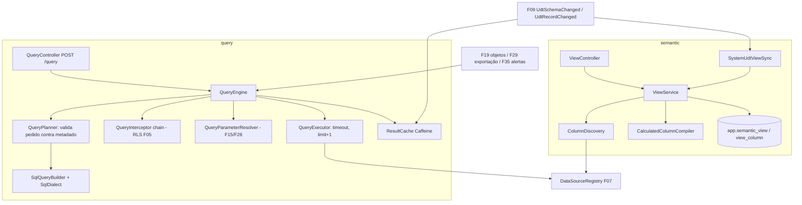

# F12 — Visões e Motor de Consulta Design

**Spec**: `.specs/features/F12-visoes-motor-consulta/spec.md`
**Status**: Draft

---

## Architecture Overview



### Montagem do SQL (exemplo)

Pedido: `valor (SUM)` por `regiao` e `data (MONTH)`, filtro `status IN ('FATURADO')`, visão SQL em Postgres.

```sql
SELECT v."regiao" AS d0, date_trunc('month', v."data") AS d1, SUM(v."valor") AS m0
FROM (<SQL da visão>) v
WHERE v."status" IN (?)              -- filtros do pedido
  AND (<predicado RLS com binds>)    -- QueryInterceptor (F05)
GROUP BY v."regiao", date_trunc('month', v."data")
ORDER BY m0 DESC
LIMIT ?                              -- min(limit, maxQueryRows) + 1
```

Para visões `TABLE`, a fonte vira `schema.tabela` com quoting do dialeto. Para `SYSTEM_UDT`, vira `udt.v_<id>` na conexão interna.

---

## Code Reuse Analysis

### Existing Components to Leverage

| Component | Location | How to Use |
| --- | --- | --- |
| `DataSourceRegistry`, `SqlDialect`, `SqlSafetyValidator` | `datasource` (F07) | Execução, dialeto, validação de SQL |
| `ObExprParser`, `TypeChecker`, `SqlCompiler` | `udt.obexpr` (F09) | Colunas calculadas; estender com `SqlDialect` e funções de agregação |
| `UdtSchemaChanged`, `UdtRecordChanged`, metadados de UDT | F09 / F06 | Visão do sistema e invalidação de cache |
| `BrowserSource` | `udt.browser` (F10) | `ViewBrowserSource` |
| `AccessControl`, `@RequiresFlag(SQL_EDITOR)` | F04 | Permissões |
| `DependencyRegistry` | F13 | Arestas e impacto |
| `LimitsProvider` | F02 | Timeout e máximo de linhas |
| `SchemaExplorer` (front), `FormulaEditor`, `DependentsModal` | F07 / F09 | Editor de visão |

### Integration Points

| System | Integration Method |
| --- | --- |
| F05 RLS | Implementa `QueryInterceptor` |
| F15 Tokens / F28 Filtros | Implementam `QueryParameterResolver` |
| F19–F22 | `QueryEngine.execute(QueryRequest, QueryContext)` + envio ao analytics |
| F29 | `QueryEngine.stream(...)` para CSV |

---

## Components

### `semantic.view.ViewService` / `ViewController`

- `create`, `update` (retorna `impact`), `delete` (`VIEW_IN_USE`, `SYSTEM_VIEW_READONLY`), `get`, `list` (`filterVisible` + categoria), `preview`, `refreshColumns`, `impact`.
- Registra arestas: `VIEW → DATASOURCE`, `VIEW → UDT_TABLE`, `VIEW_COLUMN → MASK`, `VIEW_COLUMN(calc) → VIEW_COLUMN`.
- **Location**: `backend/src/main/java/io/databoard/semantic/view/`

### `semantic.view.ColumnDiscovery`

- `List<DiscoveredColumn> discover(ViewSource)`: `WHERE 1=0` + `ResultSetMetaData`; mapeia tipos JDBC → `TEXT|INTEGER|DECIMAL|DATE|DATETIME|BOOLEAN`.
- `ColumnMerge.merge(existing, discovered)`: novas → adiciona com inferência; ausentes → `MISSING`; existentes → mantém metadados editados e atualiza o tipo.

### `semantic.view.CalculatedColumnCompiler`

- Usa `ObExprParser` + `TypeChecker` com `ViewColumnScope` (sem navegação) e `SqlCompiler(mode=BIND, dialect)`; valida agregação × papel; expande calculadas aninhadas; detecta ciclos.

### `semantic.system.SystemUdtViewSync`

- `@TransactionalEventListener(AFTER_COMMIT) on(UdtSchemaChanged)`: cria ou sincroniza a visão `SYSTEM_UDT` (recurso pai = UDT); `backfill()` no startup para UDTs sem visão.

### `query.QueryEngine` (interface pública)

- `QueryResult execute(QueryRequest req, QueryContext ctx)` e `void stream(QueryRequest, QueryContext, RowConsumer)` (sem limite de linhas de tela; limite de exportação).
- `QueryContext { CurrentUser user; UUID screenId; UUID objectId; Map<String,Object> parameters; boolean bypassCache }`.

### `query.QueryPlanner`

- Valida colunas (existe, visível, não `MISSING`), operadores × tipo, duplicatas e papéis; produz `QueryPlan`.

### `query.SqlQueryBuilder`

- `BuiltSql build(QueryPlan, ViewDefinition, SqlDialect, List<Predicate> extraPredicates)`: só identificadores do metadado; filtros → binds; `IN []` → `1=0`; totais sem `GROUP BY`.

### `query.QueryInterceptor` / `query.QueryParameterResolver` (SPI)

- `List<Predicate> predicates(ViewDefinition, QueryContext)` e `Map<String,Object> resolve(ViewDefinition, QueryContext)`.

### `query.QueryExecutor`

- `JdbcTemplate` da conexão; `setQueryTimeout`; `limit+1`; mapeia `SQLTimeoutException` → `QUERY_TIMEOUT` e falha de conexão → `DATASOURCE_UNAVAILABLE`.

### `query.ResultCache`

- Caffeine com peso por tamanho estimado; chave SHA-256 de `datasourceId + sql + binds`; índice `viewId → keys` para invalidação; listener de eventos de UDT.

### `semantic.browser.ViewBrowserSource`

- Implementa `BrowserSource` traduzindo filtros da grade para filtros do motor (somente leitura).

### Frontend — `features/views/`

- `ViewsListPage` (categoria, tipo, busca), `ViewEditorPage`:
  - aba Fonte: TABLE (conexão + `SchemaExplorer`) ou SQL (CodeMirror SQL, visível com `SQL_EDITOR`);
  - aba Colunas: grade editável (rótulo, descrição, papel, agregação, máscara, visível, status `MISSING`);
  - aba Calculadas: `CalculatedColumnDialog` reaproveitando `FormulaEditor` com escopo de visão;
  - painéis Prévia (100 linhas), Impacto e ACL.
- `ImpactAlert` exibido após salvar quando `impact` não vem vazio.

---

## Data Models

```sql
-- V12__semantic.sql
CREATE TABLE app.semantic_view (
  id uuid PRIMARY KEY, name varchar(120) NOT NULL, description text,
  type varchar(12) NOT NULL CHECK (type IN ('TABLE','SQL','SYSTEM_UDT','JOIN')),
  datasource_id uuid NOT NULL REFERENCES app.datasource(id),
  source jsonb NOT NULL,                -- {schema,table} | {sql} | {udtTableId}
  cache_ttl_seconds int NOT NULL DEFAULT 0,
  created_by uuid, created_at timestamptz NOT NULL DEFAULT now(),
  updated_at timestamptz NOT NULL DEFAULT now());
CREATE UNIQUE INDEX ux_system_view_udt ON app.semantic_view ((source->>'udtTableId')) WHERE type = 'SYSTEM_UDT';

CREATE TABLE app.view_column (
  id uuid PRIMARY KEY, view_id uuid NOT NULL REFERENCES app.semantic_view(id) ON DELETE CASCADE,
  name varchar(128) NOT NULL, label varchar(128) NOT NULL, description text,
  role varchar(10) NOT NULL, data_type varchar(10) NOT NULL,
  default_aggregation varchar(15) NOT NULL DEFAULT 'NONE',
  mask_id varchar(40), visible boolean NOT NULL DEFAULT true,
  status varchar(8) NOT NULL DEFAULT 'OK',          -- OK | MISSING
  calculated jsonb,                                 -- {mode:'OBEXPR'|'SQL', expression}
  position int NOT NULL, type_fallback boolean NOT NULL DEFAULT false,
  UNIQUE (view_id, name));
```

```json
// QueryRequest
{ "viewId": "...", "dimensions": [{ "column": "regiao" }, { "column": "data", "dateGrain": "MONTH" }],
  "measures": [{ "column": "valor", "aggregation": "SUM" }],
  "filters": [{ "column": "status", "op": "IN", "values": ["FATURADO"] }],
  "sort": [{ "column": "valor", "direction": "DESC" }], "limit": 1000, "totals": false,
  "context": { "screenId": "...", "objectId": "..." } }
```

---

## Error Handling Strategy

| Error Scenario | Handling | User Impact |
| --- | --- | --- |
| SQL não-SELECT | 400 `ONLY_SELECT_ALLOWED` | Erro no editor |
| Fonte inválida | 422 `VIEW_SOURCE_ERROR` + mensagem do banco | Erro no editor com a mensagem |
| Coluna inválida/ausente no pedido | 400 `VIEW_COLUMN_INVALID` / `VIEW_COLUMN_MISSING` | Objeto mostra erro só nele (F19) |
| Timeout | 504 `QUERY_TIMEOUT` | "Consulta demorou mais que N s" |
| Origem fora | 502 `DATASOURCE_UNAVAILABLE` | Erro só no objeto |
| Visão em uso | 409 `VIEW_IN_USE` | `DependentsModal` |

---

## Risks & Concerns

| Concern | Location (file:line) | Impact | Mitigation |
| --- | --- | --- | --- |
| `SqlCompiler` da F09 é Postgres-only | `udt.obexpr.SqlCompiler` | Calculadas falham em MySQL/SQL Server | T5 adiciona `FunctionMapping` por dialeto com teste de tabela nos 3 dialetos |
| Subconsulta `(<SQL>) v` com `ORDER BY` interno no SQL Server | `SqlQueryBuilder` | Erro "ORDER BY inválido em subquery" | Remover `ORDER BY` de topo do SQL da visão via JSqlParser na T8 ou rejeitar com mensagem |
| Cache servindo dados de outro contexto RLS | `ResultCache` | Vazamento de dados | Chave = SQL final + binds (inclui predicado RLS); teste explícito na F05 |
| Memória do cache | `ResultCache` | OOM | Peso por tamanho; máx. 200 MB; resultados > 5 MB não são cacheados |

---

## Tech Decisions (only non-obvious ones)

| Decision | Choice | Rationale |
| --- | --- | --- |
| Descoberta com `WHERE 1=0` | Em vez de `LIMIT 0` | Portável para SQL Server |
| Totais por segunda consulta | Em vez de somar no analytics | Correto para medidas não aditivas |
| Extensões RLS/tokens por SPI | `QueryInterceptor` / `QueryParameterResolver` | F05/F15/F28 entram sem mexer no motor |
