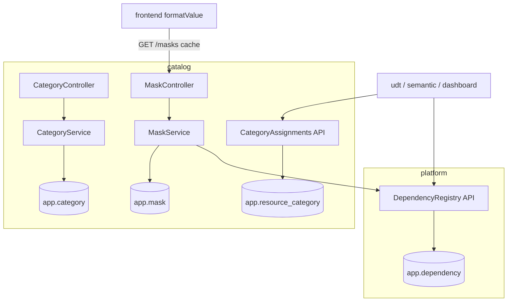

# F13/F14 — Categorias e Máscaras Design

**Spec**: `.specs/features/F13-F14-categorias-mascaras/spec.md`
**Status**: Draft

---

## Architecture Overview



---

## Code Reuse Analysis

### Existing Components to Leverage

| Component | Location | How to Use |
| --- | --- | --- |
| `ResourceRef`, `ResourceType` | `security/access` (F04) | Chave das associações e dependências |
| `@PreAuthorize` com papéis | F04 | ADMIN/BUILDER |
| `ProblemDetailsHandler` | F00 | Códigos de erro |

### Integration Points

| System | Integration Method |
| --- | --- |
| Módulos de conteúdo | `CategoryAssignments.assign/unassign/resourcesIn(categoryId, includeDescendants)` |
| Todos os módulos | `DependencyRegistry.replaceOutgoing/removeAll/dependentsOf` |
| Frontend | `useMasks()` (TanStack Query, `staleTime` 5 min) + `formatValue` |

---

## Components

### `catalog.category.CategoryService` / `CategoryController`

- **Interfaces**: `tree()`, `create(name, parentId)`, `update(id, name, parentId)` (valida ciclo e profundidade da subárvore movida), `delete(id)` (CTE recursiva apaga subárvore e associações).
- **Location**: `backend/src/main/java/io/databoard/catalog/category/`

### `catalog.category.CategoryAssignments` (API pública)

- `void assign(ResourceRef r, UUID categoryIdOrNull)`, `Set<UUID> resourcesIn(ResourceType t, UUID categoryId)` (inclui descendentes), `Optional<UUID> categoryOf(ResourceRef r)`, `void unassign(ResourceRef r)`.

### `catalog.mask.MaskService` / `MaskController`

- Predefinidas carregadas de `masks-builtin.json` (classpath) e mescladas em memória com as customizadas do banco.
- `delete(id)`: consulta `dependentsOf(MASK, id)` → `MASK_IN_USE`.
- Validação de padrão ICU com `java.text.SimpleDateFormat`/`DateTimeFormatter.ofPattern`.

### `platform.dependency.DependencyRegistry` (API pública)

- `replaceOutgoing(DepRef from, Set<DepRef> to)`, `removeAll(DepRef from)`, `List<Dependent> dependentsOf(DepRef to)`.
- `DepRef(type, id)`, com tipos abertos (string): `UDT_TABLE`, `UDT_FIELD`, `VIEW`, `VIEW_COLUMN`, `SCREEN`, `SCREEN_OBJECT`, `MASK`, `DATASOURCE`, `RLS_RULE`, `FILTER`, `BROWSER`.
- `NameResolver` SPI: cada módulo registra como obter o nome legível dos seus tipos (para a lista de dependentes).

### Frontend — `shared/format/`

- `formatValue(value: unknown, mask?: Mask): { text: string; color?: string }`
- `maskToEChartsFormatter(mask)` (usado na F22)
- `useMasks()` + `useFormatter(maskId)`
- `features/catalog/CategoryTree` (árvore Mantine com criar/renomear/mover/excluir) e `CategorySelect` (select hierárquico reutilizável nos formulários de recurso)
- `features/catalog/MasksPage` + `MaskFormModal` com pré-visualização ao vivo

---

## Data Models

```sql
-- V7__catalog.sql
CREATE TABLE app.category (
  id uuid PRIMARY KEY, parent_id uuid REFERENCES app.category(id) ON DELETE CASCADE,
  name varchar(80) NOT NULL, created_at timestamptz NOT NULL DEFAULT now());
CREATE UNIQUE INDEX ux_category_sibling ON app.category (coalesce(parent_id, '00000000-0000-0000-0000-000000000000'), lower(name));

CREATE TABLE app.resource_category (
  resource_type varchar(20) NOT NULL, resource_id uuid NOT NULL,
  category_id uuid NOT NULL REFERENCES app.category(id) ON DELETE CASCADE,
  PRIMARY KEY (resource_type, resource_id));

CREATE TABLE app.mask (
  id uuid PRIMARY KEY, name varchar(80) NOT NULL UNIQUE,
  kind varchar(10) NOT NULL CHECK (kind IN ('NUMBER','DATE','TEXT')),
  config jsonb NOT NULL, created_at timestamptz NOT NULL DEFAULT now());

CREATE TABLE app.dependency (
  from_type varchar(30) NOT NULL, from_id uuid NOT NULL,
  to_type varchar(30) NOT NULL, to_id uuid NOT NULL,
  PRIMARY KEY (from_type, from_id, to_type, to_id));
CREATE INDEX ix_dependency_to ON app.dependency (to_type, to_id);
```

```ts
type Mask =
  | { id: string; kind: 'NUMBER'; builtIn: boolean; prefix?: string; suffix?: string; decimals: number;
      thousandSep: boolean; scale?: 1 | 1000 | 1000000; scaleSuffix?: string; percent?: boolean;
      currency?: 'BRL'|'USD'|'EUR'; negativeColor?: string }
  | { id: string; kind: 'DATE'; builtIn: boolean; pattern: string }          // ICU
  | { id: string; kind: 'TEXT'; builtIn: boolean; pattern: string }          // '###.###.###-##'
```

---

## Error Handling Strategy

| Error Scenario | Handling | User Impact |
| --- | --- | --- |
| Profundidade > 3 | 400 `CATEGORY_DEPTH_EXCEEDED` | Aviso no formulário |
| Ciclo | 400 `CATEGORY_CYCLE` | Movimento recusado |
| Máscara predefinida alterada | 409 `MASK_BUILT_IN` | Botões ocultos na UI |
| Máscara em uso | 409 `MASK_IN_USE` + `dependents[]` | Modal com a lista de quem usa |

---

## Risks & Concerns

| Concern | Location (file:line) | Impact | Mitigation |
| --- | --- | --- | --- |
| Módulos esquecerem de atualizar `app.dependency` | Todas as features que salvam referências | Exclusão indevida permitida | Cada feature consumidora tem AC/teste de "X em uso → 409"; revisão no Verifier |
| `Intl` difere entre navegadores (espaço fino em `R$`) | `formatValue` | Testes frágeis | Normalizar ` ` para espaço nos testes; aceitar o caractere do `Intl` na UI |

---

## Tech Decisions (only non-obvious ones)

| Decision | Choice | Rationale |
| --- | --- | --- |
| Registro de dependências em tabela genérica | `app.dependency` com tipos string | Um mecanismo para `*_IN_USE` e análise de impacto em todas as features (registrado como AD-019) |
| Predefinidas em JSON do classpath | Não ficam no banco | Imutáveis e versionadas com o código |
