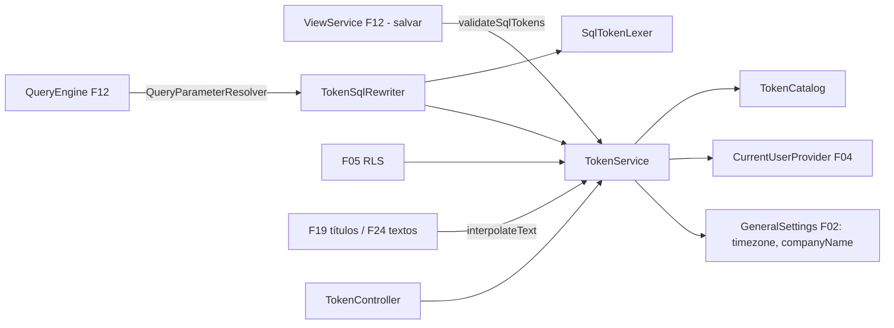

# F15 — Tokens Design

**Spec**: `.specs/features/F15-tokens/spec.md`
**Status**: Draft

---

## Architecture Overview

O rewriter roda sobre o SQL da visão **antes** de ele ser embrulhado como subconsulta pelo `SqlQueryBuilder`. Os binds dos tokens vêm antes dos binds dos filtros, na ordem de aparição.

---

## Code Reuse Analysis

### Existing Components to Leverage

| Component | Location | How to Use |
| --- | --- | --- |
| `QueryParameterResolver` SPI | `query` (F12) | Ponto de entrada no motor |
| `ViewService` | `semantic.view` (F12) | Validação no salvamento |
| `CurrentUser` (atributos multivalorados, grupos) | F04 | Valores de usuário |
| `GeneralSettings` | F02 | Fuso e nome da empresa |
| CodeMirror | F09 | Autocomplete |

### Integration Points

| System | Integration Method |
| --- | --- |
| F05 | `TokenService.resolve(name, ctx)` nos predicados simples e o rewriter nos avançados |
| F28 | Valores padrão de filtro por token |
| F35/F37 (V1) | Resolução no contexto do destinatário (`ctx.user` = destinatário) |

---

## Components

### `semantic.token.TokenCatalog`

- `Optional<TokenDef> find(String name)`; `TokenDef { name, type, multiValue, description }`.
- **Location**: `backend/src/main/java/io/databoard/semantic/token/`

### `semantic.token.TokenService`

- `TokenValue resolve(String name, TokenContext ctx)`: `TokenValue { type, List<Object> values }`.
- `String interpolateText(String text, TokenContext ctx)`.
- `List<String> unknownTokens(String sql)` → usado por `validateSqlTokens`.
- `TokenContext { CurrentUser user; ZoneId zone; Clock clock }`.

### `semantic.token.SqlTokenLexer`

- Máquina de estados simples (normal, literal simples, dollar-quoted, identificador entre aspas, comentário de linha, comentário de bloco) que devolve `TokenOccurrence { name, start, end, insideInList }`. Detecta `IN (` imediatamente antes da ocorrência (ignorando espaços).

### `semantic.token.TokenSqlRewriter`

- `RewrittenSql rewrite(String sql, TokenContext ctx)`: devolve SQL com `?` e a lista ordenada de binds com tipo JDBC.

### `semantic.token.TokenController`

- `GET /api/v1/tokens`, `POST /api/v1/tokens/preview`.

### Frontend — `shared/tokens/`

- `useTokenCatalog()`, `tokenCompletion` (extensão CodeMirror), usado no editor SQL de visão, no editor de RLS avançado e no editor de texto/título.

---

## Data Models

Sem tabelas novas no MVP. (V1: `app.custom_token(name, kind, value | view_query, cache_minutes)`.)

---

## Error Handling Strategy

| Error Scenario | Handling | User Impact |
| --- | --- | --- |
| Token desconhecido no SQL | 400 `UNKNOWN_TOKEN` + nome | Erro no editor de visão |
| Multivalor em comparação escalar | 400 `TOKEN_MULTIVALUE_IN_SCALAR` | Erro no objeto, com o nome do token |
| Token desconhecido em texto | Mantido literal | Título mostra `{{x}}` (visível ao construtor) |

---

## Risks & Concerns

| Concern | Location (file:line) | Impact | Mitigation |
| --- | --- | --- | --- |
| Lexer próprio errar em sintaxes exóticas de dialeto | `SqlTokenLexer` | Token não substituído ou substituído dentro de literal | Tabela de testes por dialeto (Postgres `$$`, MySQL `` ` ``, SQL Server `[ ]` e `N''`); token não substituído vira erro de SQL, nunca vazamento |
| Ordem de binds entre tokens e filtros | `SqlQueryBuilder` (F12) | Binds trocados | Rewriter devolve binds próprios; builder concatena na ordem fonte → filtros → RLS; teste de integração dedicado |

---

## Tech Decisions (only non-obvious ones)

| Decision | Choice | Rationale |
| --- | --- | --- |
| Lexer próprio em vez de JSqlParser | Estado mínimo | JSqlParser não aceita `{{x}}` como sintaxe; o lexer só precisa saber o que é literal e comentário |
| Interpolação de texto no servidor | `TokenService.interpolateText` | Mesmo resultado em tela, PDF (V1) e e-mail (V1) |
