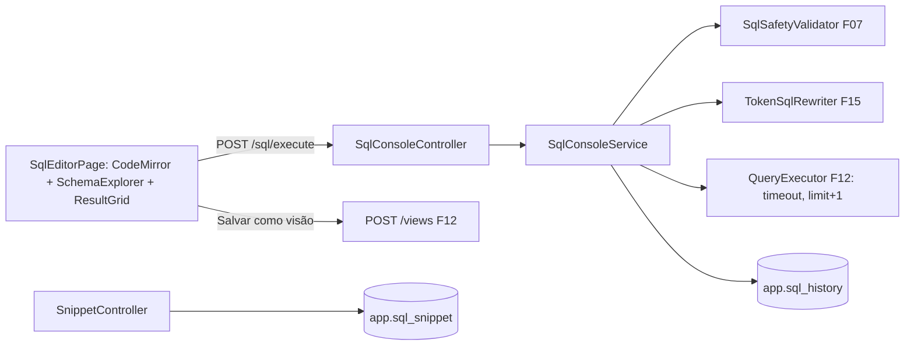

# F17 — Editor SQL Design

**Spec**: `.specs/features/F17-editor-sql/spec.md`
**Status**: Draft

---

## Architecture Overview



O console reaproveita o `QueryExecutor` da F12 (timeout, truncamento, mapeamento de erros) com o SQL do usuário, sem passar pelo planner: aqui não há visão.

---

## Code Reuse Analysis

### Existing Components to Leverage

| Component | Location | How to Use |
| --- | --- | --- |
| `SqlSafetyValidator`, `DataSourceRegistry` | F07 | Validação e conexão somente leitura |
| `QueryExecutor` | `query` (F12) | Execução com limites |
| `TokenSqlRewriter` | F15 | Tokens como binds |
| `SchemaExplorer` (front) + `GET /datasources/{id}/schema` | F07 | Explorador e autocomplete |
| `POST /views` | F12 | Salvar como visão |
| CodeMirror, `tokenCompletion` | F09 / F15 | Editor |

---

## Components

### `query.console.SqlConsoleService` / `SqlConsoleController`

- `ConsoleResult execute(UUID datasourceId, String sql, CurrentUser)`: checa flag e `VIEW`, tamanho ≤ 100 KB, vazio, `validateSelectOnly`, rewriter de tokens, `QueryExecutor`, mapeia SQLState `42501` → `PERMISSION_DENIED_SOURCE` e erro de sintaxe → `SQL_ERROR`; grava histórico (sempre) e apaga além das 50 mais recentes.
- `POST /api/v1/sql/execute`, `GET /api/v1/sql/history`.
- **Location**: `backend/src/main/java/io/databoard/query/console/`

### `query.console.SnippetService` / `SnippetController`

- `GET|POST /api/v1/sql/snippets`, `PUT|DELETE /api/v1/sql/snippets/{id}` (só do dono; outros → 404).

### Frontend — `features/sql/`

- `SqlEditorPage`: seletor de conexão, `SchemaExplorer` lateral (insere nome no cursor), editor CodeMirror (SQL + schema para autocomplete + tokens), botões "Executar" (Ctrl+Enter, seleção ou tudo), "Salvar como visão", "Criar objeto", "Salvar snippet".
- `SqlResultGrid` (TanStack Table + virtualização; aviso "resultado truncado").
- `SqlHistoryPanel`, `SnippetsPanel`.

---

## Data Models

```sql
-- V14__sql_console.sql
CREATE TABLE app.sql_history (
  id bigserial PRIMARY KEY, user_id uuid NOT NULL, datasource_id uuid NOT NULL,
  sql text NOT NULL, status varchar(8) NOT NULL, duration_ms int, row_count int,
  error_code varchar(40), executed_at timestamptz NOT NULL DEFAULT now());
CREATE INDEX ix_sql_history_user ON app.sql_history (user_id, executed_at DESC);

CREATE TABLE app.sql_snippet (
  id uuid PRIMARY KEY, user_id uuid NOT NULL, name varchar(120) NOT NULL,
  datasource_id uuid, sql text NOT NULL,
  created_at timestamptz NOT NULL DEFAULT now(), updated_at timestamptz NOT NULL DEFAULT now());
```

---

## Error Handling Strategy

| Error Scenario | Handling | User Impact |
| --- | --- | --- |
| Não-SELECT | 400 `ONLY_SELECT_ALLOWED` | Mensagem acima da grade |
| Erro de sintaxe do banco | 400 `SQL_ERROR` + mensagem | Mensagem do banco exibida |
| Permissão negada (interna) | 400 `PERMISSION_DENIED_SOURCE` | "Esta conexão não permite acessar esse objeto" |
| Timeout | 504 `QUERY_TIMEOUT` | "Consulta excedeu N s" |
| Truncado | `truncated=true` | Aviso "mostrando N linhas" |

---

## Risks & Concerns

| Concern | Location (file:line) | Impact | Mitigation |
| --- | --- | --- | --- |
| Editor SQL na conexão interna ignora RLS e ACL de dados das UDTs | `SqlConsoleService` | Leitura ampla de dados por quem tem a flag | Exige `VIEW` explícito na conexão interna (não herdado); aviso fixo na tela de ACL da conexão interna; documentado em `docs/operacao.md` |
| Resultados grandes no navegador | `SqlResultGrid` | Lentidão | Virtualização + limite da F02 |

---

## Tech Decisions (only non-obvious ones)

| Decision | Choice | Rationale |
| --- | --- | --- |
| Reutilizar `QueryExecutor` | Sem duplicar timeout/truncamento | Mesmos limites e erros do motor |
| Histórico grava também falhas | Sim | Usuário reabre e corrige a consulta |
