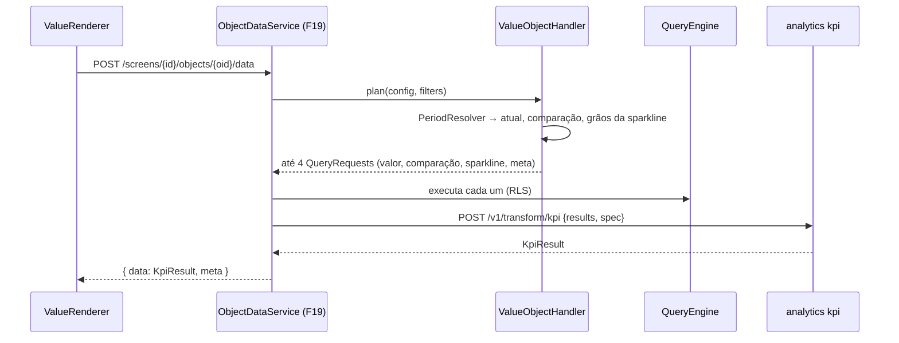

# F20 — Objeto Valor Design

**Spec**: `.specs/features/F20-objeto-valor/spec.md`
**Status**: Draft

---

## Architecture Overview



---

## Code Reuse Analysis

### Existing Components to Leverage

| Component | Location | How to Use |
| --- | --- | --- |
| `ObjectTypeHandler`, `ObjectDataService`, `objectRegistry`, `ObjectConfigDrawer` | F19 | Plug-in do tipo |
| Registry de transforms | analytics (F19) | Kind `kpi` |
| `QueryRequest` com filtro `BETWEEN` e `dateGrain` | F12 | Consultas |
| `GeneralSettings.timezone` | F02 | Períodos |
| `formatValue`, `maskToEChartsFormatter` | F13/F14 | Valor e sparkline |

---

## Components

### `dashboard.object.value.PeriodResolver`

- `Period current(DefaultPeriod p, Optional<DateRange> activeFilter, ZoneId zone, Clock clock)`.
- `Period previous(Period p)`: período calendário completo → calendário anterior; senão, mesmo comprimento imediatamente antes.
- `Period sameLastYear(Period p)`, `List<Period> sparklineGrains(Period p, DateGrain g, int n=12)`.
- **Location**: `backend/src/main/java/io/databoard/dashboard/object/value/`

### `dashboard.object.value.ValueObjectHandler`

- `validate`: visão/medida existem; comparativo de período exige `dateColumn`; `ALL` incompatível com comparativo de período; meta `MEASURE` com visão + medida + coluna de data.
- `dependencies`: `VIEW`, `VIEW_COLUMN` (medida, data), visão e colunas da meta, `MASK`, `SCREEN` destino.
- `plan`: Q1 valor (sem dimensões, filtro `BETWEEN` atual); Q2 comparação (período deslocado ou outra medida); Q3 sparkline (dimensão `dateColumn` com `dateGrain`, filtro do intervalo dos 12 grãos); Q4 meta. `transformKind="kpi"`, `spec = { aggregation, higherIsBetter, comparison, target, sparkline: { grains: [...] } }`.

### analytics — `transforms/kpi.py`

- `kpi(req) -> KpiResult { value, comparisonValue, delta, deltaPct, direction, sentiment, target, targetAttainmentPct, sparkline: [{ period, value }] }`.
- Preenchimento de grãos com polars (`join` com a lista de grãos do `spec`).

### Frontend — `features/screens/objects/value/`

- `ValueRenderer`: card Mantine; ECharts minimalista para a sparkline; cores por `sentiment` a partir de tokens do tema.
- `ValueEditor`: formulário do objeto.
- Registro: `objectRegistry.VALUE = { Renderer, Editor, defaultSize: { w: 3, h: 3 } }`.

---

## Data Models

```json
// config do objeto VALUE
{ "viewId": "...", "measure": { "column": "valor", "aggregation": "SUM" }, "maskId": "brl", "icon": "currency",
  "dateColumn": "data_emissao", "defaultPeriod": "CURRENT_MONTH",
  "comparison": { "kind": "PREVIOUS_PERIOD" }, "higherIsBetter": true,
  "target": { "kind": "MEASURE", "viewId": "...", "measure": { "column": "valor", "aggregation": "SUM" }, "dateColumn": "mes" },
  "sparkline": { "enabled": true, "grain": "MONTH" },
  "onClick": { "navigateToScreenId": null } }
```

---

## Error Handling Strategy

| Error Scenario | Handling | User Impact |
| --- | --- | --- |
| Config inválida | 400 com caminho do campo (F19) | Campo destacado no editor |
| Falha só na consulta da meta | Meta `null`, demais valores presentes | KPI sem barra de meta |
| Falha na consulta principal | Erro do objeto (F19) | Mensagem só no objeto |

---

## Risks & Concerns

| Concern | Location (file:line) | Impact | Mitigation |
| --- | --- | --- | --- |
| Quatro consultas por KPI | `ValueObjectHandler.plan` | Carga com muitos KPIs | Consultas leves (sem dimensão ou 12 linhas) + coalescer/cache (F12/F19) |
| Fuso entre banco e instância | `PeriodResolver` | Bordas de dia erradas | Filtros por data (`DATE`) no fuso da instância; para `DATETIME`, limites convertidos para UTC |

---

## Tech Decisions (only non-obvious ones)

| Decision | Choice | Rationale |
| --- | --- | --- |
| Falha parcial da meta não derruba o objeto | Captura por consulta secundária | KPI principal é o que importa |
| Períodos calculados no Spring | Não no analytics | Viram filtros do motor (RLS e binds) |
