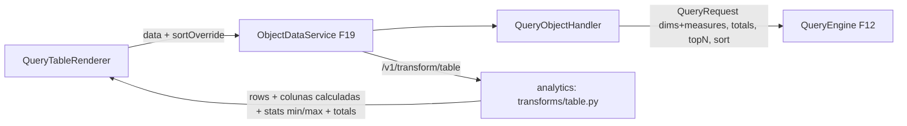

# F21 — Objeto Consulta Design

**Spec**: `.specs/features/F21-objeto-consulta/spec.md`
**Status**: Draft

---

## Architecture Overview



---

## Code Reuse Analysis

### Existing Components to Leverage

| Component | Location | How to Use |
| --- | --- | --- |
| `ObjectTypeHandler`, `ObjectDataService`, `objectRegistry` | F19 | Plug-in do tipo `QUERY` |
| `QueryEngine` com `totals` e `sortOverride` | F12 | Dados e total |
| Registry de transforms | analytics (F19) | Kind `table` |
| `formatValue` | F13/F14 | Células |
| TanStack Table + Virtual | Front (F10) | Grade |

---

## Components

### `dashboard.object.query.QueryObjectHandler`

- `validate`: colunas existem na visão, sem duplicatas, `topN` ≤ `maxQueryRows`, `linkTemplate` só `http(s)`, colunas calculadas apontam para medidas da tabela.
- `dependencies`: `VIEW`, cada `VIEW_COLUMN`, `MASK`s.
- `plan`: um `QueryRequest` (`totals = showTotals || algum PERCENT_OF_TOTAL/CUMULATIVE_PCT`, `limit = topN`, `sort = sortOverride ?? defaultSort`), `transformKind="table"`, `spec = { columns, calculatedColumns, needsStats: [colunas DATA_BAR] }`.
- **Location**: `backend/src/main/java/io/databoard/dashboard/object/query/`

### analytics — `transforms/table.py`

- `table(req) -> TableResult { columns: [...], rows, totals, stats: { col: { min, max } } }`.
- Colunas calculadas com expressões polars: `pct_of_total = col / total`, `cum_sum`, `rank("dense", descending=True)`, `diff()`.

### Frontend — `features/screens/objects/query/`

- `QueryTableRenderer`: TanStack Table com virtualização, redimensionamento, ordenação local/remota, linha de total fixa no rodapé, renderers de célula (`MaskedCell`, `DataBarCell`, `ImageCell`, `LinkCell`).
- `QueryTableEditor`: escolher visão, dimensões e medidas (arrastar para ordenar), ordenação padrão, `topN`, total, colunas calculadas, formatação por coluna.

---

## Data Models

```json
// config do objeto QUERY
{ "viewId": "...",
  "columns": [
    { "column": "produto", "role": "DIMENSION", "label": "Produto", "display": "IMAGE_AND_TEXT" },
    { "column": "valor", "role": "MEASURE", "aggregation": "SUM", "maskId": "brl", "display": "DATA_BAR", "align": "right" }
  ],
  "calculatedColumns": [
    { "key": "pct", "label": "% do total", "kind": "PERCENT_OF_TOTAL", "baseColumn": "valor", "maskId": "pct1" },
    { "key": "rank", "label": "#", "kind": "RANK", "baseColumn": "valor" }
  ],
  "defaultSort": [{ "column": "valor", "direction": "DESC" }], "topN": 10, "showTotals": true }
```

---

## Error Handling Strategy

| Error Scenario | Handling | User Impact |
| --- | --- | --- |
| Config inválida | 400 com caminho (F19) | Campo destacado |
| Total 0 em % do total | `null` nas linhas | Células com "—" |
| Imagem quebrada | Placeholder | Nenhum erro |

---

## Risks & Concerns

| Concern | Location (file:line) | Impact | Mitigation |
| --- | --- | --- | --- |
| Ordenação local diverge da ordem do banco (collation) | `QueryTableRenderer` | Ordem diferente após clique | `Intl.Collator('pt-BR')` no cliente; consulta remota quando truncado |
| Colunas calculadas dependem da ordem final | `table.py` | Acumulado errado após reordenar no cliente | Reordenação local recalcula só `RANK`; acumulado/diferença exibem aviso "calculado na ordem padrão" quando a ordem local difere |

---

## Tech Decisions (only non-obvious ones)

| Decision | Choice | Rationale |
| --- | --- | --- |
| Colunas calculadas no analytics | Não no SQL | Expressões de janela simples em polars; mesmas regras na exportação XLSX (F29) |
| % do total sobre o total do motor | Não sobre as linhas exibidas | Correto com top N |
