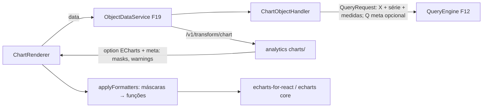

# F22 — Objeto Gráfico Design

**Spec**: `.specs/features/F22-objeto-grafico/spec.md`
**Status**: Draft

---

## Architecture Overview



### Estrutura no analytics

```
transforms/charts/
├── __init__.py        # kind "chart" → dispatch por type
├── prepare.py         # pivot long→wide, ordenação, limite de categorias/séries + "Outros", 100%
├── palette.py         # paleta categórica da plataforma
├── builders/
│   ├── cartesian.py   # BAR, LINE, AREA, COMBO
│   ├── pie.py         # PIE, DONUT
│   ├── scatter.py
│   └── funnel.py
└── options.py         # eixos, legenda, labels, markLine, cores
```

---

## Code Reuse Analysis

### Existing Components to Leverage

| Component | Location | How to Use |
| --- | --- | --- |
| `ObjectTypeHandler`, `ObjectDataService` (consultas opcionais da F20), `objectRegistry` | F19/F20 | Plug-in `CHART` |
| Registry de transforms | analytics (F19) | Kind `chart` |
| `maskToEChartsFormatter` | F13/F14 | Formatters de tooltip/label/eixo |
| Skill `dataviz` | — | Paleta, tipografia e regras de marca do gráfico |

---

## Components

### `dashboard.object.chart.ChartObjectHandler`

- `validate`: restrições por tipo (spec), colunas existem, `maxCategories` 2–500, cores em hex.
- `dependencies`: `VIEW`, `VIEW_COLUMN`s, `MASK`s, visão da meta.
- `plan`: Q1 com dimensões `[x, series?]` e medidas; Q2 meta (opcional); `transformKind="chart"`, `spec` = config de apresentação + agregações das medidas (para decidir "Outros").
- **Location**: `backend/src/main/java/io/databoard/dashboard/object/chart/`

### analytics — `transforms/charts`

- `chart(req) -> { option: dict, meta: { valueMasks: { seriesIndex: maskId }, axisMasks, warnings: [...] } }`.
- `prepare.py`: `limit_categories(df, n, additive)`, `normalize_percent(df)`, `order_categories(df, rule)`.
- Builders puros e testáveis por snapshot (`syrupy`).

### Frontend — `features/screens/objects/chart/`

- `ChartRenderer`: importa só os módulos necessários do ECharts (`echarts/core` + charts usados); `applyFormatters(option, meta, masks)`; ícone de avisos; `ResizeObserver` para acompanhar o grid; estado vazio.
- `ChartEditor`: tipo (com prévia de ícones), dados (X, série, medidas com bar/line e eixo para COMBO), aparência (orientação, empilhamento, eixos, legenda, rótulos, cores, meta, `maxCategories`), troca de tipo sem perder config.
- `chartConfigCompat.ts`: `validateForType(config, type) → FieldError[]` (mesmas regras do backend, para feedback imediato).

---

## Data Models

```json
// config do objeto CHART
{ "viewId": "...", "chartType": "BAR",
  "x": { "column": "regiao" }, "series": { "column": "canal" },
  "measures": [ { "column": "valor", "aggregation": "SUM", "maskId": "brl", "render": "bar", "axis": "primary" } ],
  "orientation": "VERTICAL", "stack": "STACKED",
  "axis": { "min": null, "max": null, "log": false },
  "legend": { "position": "bottom" }, "dataLabels": false,
  "colors": { "bySeries": { "Online": "#1f6feb" }, "byValue": {} },
  "targetLine": { "kind": "FIXED", "value": 100000, "label": "Meta" },
  "maxCategories": 50, "categoryOrder": "AUTO" }
```

---

## Error Handling Strategy

| Error Scenario | Handling | User Impact |
| --- | --- | --- |
| Config incompatível com o tipo | 400 com campo (backend) + aviso imediato (front) | Campo destacado no editor |
| Muitas categorias/séries | Aviso no `meta.warnings` | Ícone de aviso no objeto |
| Escala log inválida | Aviso + escala linear | Ícone de aviso |
| Sem dados | `option` vazio + flag | "Sem dados" |

---

## Risks & Concerns

| Concern | Location (file:line) | Impact | Mitigation |
| --- | --- | --- | --- |
| Acoplamento ao schema de `option` do ECharts | `transforms/charts` | Upgrade do ECharts quebra gráficos | Fixar a versão do ECharts no front; snapshots de `option` no analytics detectam mudanças |
| Bundle do ECharts grande | Front | Carregamento lento | Import modular (`echarts/core`) + `React.lazy` no renderer |

---

## Tech Decisions (only non-obvious ones)

| Decision | Choice | Rationale |
| --- | --- | --- |
| "Outros" só para aditivas | Regra explícita | Somar médias produz número errado |
| Validação duplicada (front e back) | `chartConfigCompat.ts` espelha o handler | Feedback imediato; o backend continua sendo a autoridade |
