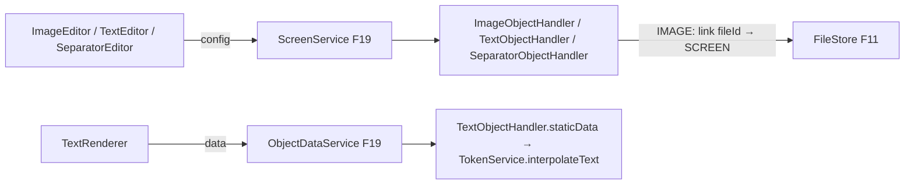

# F24 — Objetos Estáticos Design

**Spec**: `.specs/features/F24-objetos-estaticos/spec.md`
**Status**: Draft

---

## Architecture Overview



Os handlers são `isStatic() = true`: o `ObjectDataService` não chama motor nem analytics. O `TextObjectHandler` implementa `staticData(config, ctx)` para devolver o texto interpolado. Esse método é um gancho opcional novo no `ObjectTypeHandler` (padrão: devolve a própria config).

---

## Code Reuse Analysis

### Existing Components to Leverage

| Component | Location | How to Use |
| --- | --- | --- |
| `ObjectTypeHandler`, `ObjectDataService`, `objectRegistry` | F19 | Plug-in dos 3 tipos |
| `FileStore.link`, `POST /files`, `FileAccessPolicy` | F11 | Upload e acesso à imagem |
| `TokenService.interpolateText` | F15 | Tokens no texto |
| `tokenCompletion` | F15 | Autocomplete no editor de texto |

---

## Components

### `dashboard.object.statics.ImageObjectHandler`

- `validate`: `fileId` existe e é imagem, ou `url` `http(s)`; `link` `http(s)` ou rota interna; `fit` ∈ {`cover`,`contain`}.
- `dependencies`: `FILE:fileId`. Ao salvar a tela, o `ScreenService` chama `FileStore.link(fileId, SCREEN:id)` para objetos de imagem (gancho `onSaved`).
- **Location**: `backend/src/main/java/io/databoard/dashboard/object/statics/`

### `dashboard.object.statics.TextObjectHandler`

- `validate`: `markdown` ≤ 20.000 caracteres.
- `staticData`: `{ markdown: interpolateText(config.markdown, ctx) }`.

### `dashboard.object.statics.SeparatorObjectHandler`

- `validate`: `style` ∈ {`line`,`space`}, espessura 1–4, cor da paleta ou hex.

### Frontend — `features/screens/objects/statics/`

- `ImageRenderer` (fit, link, placeholder com `alt`), `ImageEditor` (upload via `Dropzone` ou URL, fit, link, alt).
- `TextRenderer` (`react-markdown` + `remark-gfm`, `skipHtml`, links externos com `rel="noopener noreferrer"`), `TextEditor` (CodeMirror markdown + tokens + prévia).
- `SeparatorRenderer`, `SeparatorEditor`.

---

## Data Models

```json
{ "type": "IMAGE", "config": { "fileId": "...", "url": null, "fit": "contain", "link": "/telas/2b1c...", "alt": "Logo" } }
{ "type": "TEXT", "config": { "markdown": "## Vendas\nAtualizado em {{hoje}}" } }
{ "type": "SEPARATOR", "config": { "style": "line", "thickness": 1, "color": "gray.4" } }
```

---

## Error Handling Strategy

| Error Scenario | Handling | User Impact |
| --- | --- | --- |
| URL/link com esquema proibido | 400 no campo | Campo destacado |
| Arquivo inexistente ou não imagem | 400 em `config.fileId` | Pedir novo upload |
| Imagem externa quebrada | Placeholder | Nenhum erro |

---

## Risks & Concerns

| Concern | Location (file:line) | Impact | Mitigation |
| --- | --- | --- | --- |
| XSS via markdown | `TextRenderer` | Execução de script | `skipHtml` + sem `rehype-raw` + testes com payloads |
| Imagem externa revela IP do usuário a terceiros | `ImageRenderer` | Privacidade | Documentado; recomendado upload em vez de URL |

---

## Tech Decisions (only non-obvious ones)

| Decision | Choice | Rationale |
| --- | --- | --- |
| Gancho `staticData` no framework | Extensão opcional do `ObjectTypeHandler` | Texto precisa do contexto do usuário sem consulta |
| Markdown em vez de rich text WYSIWYG | CodeMirror + prévia | Menos superfície de XSS e menos dependências |
