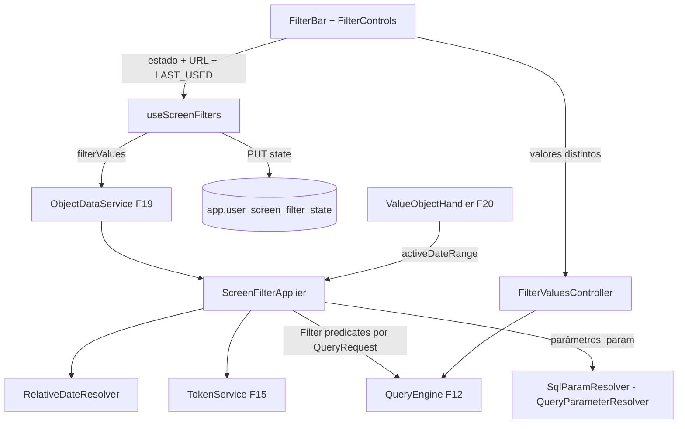

# F28 — Filtros Design

**Spec**: `.specs/features/F28-filtros/spec.md`
**Status**: Draft

---

## Architecture Overview



---

## Code Reuse Analysis

### Existing Components to Leverage

| Component | Location | How to Use |
| --- | --- | --- |
| `ObjectDataService`, `ScreenDefinitionValidator`, `ObjectFrame` | F19 | Ponto de aplicação, validação, indicador |
| `QueryEngine`, `QueryParameterResolver`, filtros do motor | F12 | Predicados e parâmetros |
| `SqlTokenLexer` | F15 | Localizar `:param` fora de literais (estender para `:nome`) |
| `TokenService` | F15 | Padrão por token |
| `PeriodResolver` | F20 | Recebe `activeDateRange` |

---

## Components

### `dashboard.filter.ScreenFilterApplier`

- `AppliedFilters apply(ScreenDefinition def, ScreenObject obj, Map<String,Object> filterValues, CurrentUser user)`:
  - para cada filtro de tela com valor: resolve o alvo no objeto (mapeamento ou coluna homônima) → `Filter` do motor ou parâmetro;
  - soma os filtros fixos do objeto;
  - valida tipos (`INVALID_FILTER_VALUE`);
  - expõe `Optional<DateRange> activeDateRange(String column)`.
- Usado pelo `ObjectDataService` antes de `handler.plan` (o plano recebe `AppliedFilters`).
- **Location**: `backend/src/main/java/io/databoard/dashboard/filter/`

### `dashboard.filter.RelativeDateResolver`

- `DateRange resolve(RelativeDate preset, ZoneId, Clock)` para os 7 atalhos.

### `semantic.view.SqlParamResolver`

- `QueryParameterResolver` que troca `:nome` (fora de literais/comentários; ignora `::` de cast do Postgres) por bind(s) do `QueryContext.parameters`; lista → `?, ?`; ausente → `NULL`.

### `dashboard.filter.FilterValuesController`

- `GET /api/v1/screens/{id}/filters/{filterId}/values?q=&page=`: exige `VIEW` na tela; `QueryEngine` com dimensão = coluna-fonte, sem medidas, `CONTAINS q`, ordenado, `limit 100` + offset; `authorizedVia=SCREEN`.

### `dashboard.filter.FilterStateController`

- `GET|PUT /api/v1/screens/{id}/filter-state` (valores `LAST_USED` do usuário).

### Validação

- `ScreenDefinitionValidator` (F19) estendido: máx. 20 filtros, slugs únicos, coluna-fonte existe, mapeamentos válidos, filtros de objeto com colunas existentes.

### Frontend — `features/screens/filters/`

- `useScreenFilters(screen)`: valor inicial (URL > LAST_USED > padrão), sincronização com URL (`useSearchParams`), `PUT filter-state` com debounce, `requiredMissing`.
- `FilterBar` + controles: `SelectFilter` (async, busca, paginação), `TextFilter`, `NumberRangeFilter`, `DateRangeFilter` (atalhos + personalizado), `BooleanFilter`.
- `ObjectFilterIndicator` no `ObjectFrame`.
- Editor: `ScreenFiltersEditor` (definir filtro, padrão, obrigatório, mapeamentos por objeto com sugestão automática) e `ObjectFiltersEditor` (filtros fixos do objeto).
- `filterUrlCodec.ts`: (de)serialização da URL.

---

## Data Models

```json
// definition.filters[]
{ "id": "f1", "slug": "periodo", "label": "Período", "control": "DATE_RANGE",
  "source": { "viewId": "...", "column": "data_emissao" },
  "default": { "kind": "RELATIVE_DATE", "value": "CURRENT_MONTH" }, "required": false,
  "mappings": { "<objectId>": { "kind": "COLUMN", "column": "data_pedido" },
                "<objectId2>": { "kind": "PARAMETER", "name": "inicio_periodo", "rangePart": "START" },
                "<objectId3>": { "kind": "IGNORE" } } }

// objects[].config.filters[] (filtro de objeto)
{ "column": "status", "op": "IN", "values": ["FATURADO"], "visible": false }
```

```sql
-- V16__filter_state.sql
CREATE TABLE app.user_screen_filter_state (
  user_id uuid NOT NULL, screen_id uuid NOT NULL REFERENCES app.screen(id) ON DELETE CASCADE,
  values jsonb NOT NULL, updated_at timestamptz NOT NULL DEFAULT now(),
  PRIMARY KEY (user_id, screen_id));
```

---

## Error Handling Strategy

| Error Scenario | Handling | User Impact |
| --- | --- | --- |
| Valor incompatível | 400 `INVALID_FILTER_VALUE` no objeto | Mensagem no objeto; controle destacado |
| Filtro obrigatório vazio | Front não consulta | "Selecione Período para ver os dados" |
| Filtro da URL inexistente | Ignorado | Nenhum |
| Mapeamento inválido ao salvar | 400 com caminho | Campo destacado no editor |

---

## Risks & Concerns

| Concern | Location (file:line) | Impact | Mitigation |
| --- | --- | --- | --- |
| `:param` confundido com cast `::type` ou com sintaxe de outros dialetos | `SqlParamResolver` | SQL quebrado | Lexer ignora `::` e `:` dentro de literais; testes por dialeto |
| Valores distintos de coluna com cardinalidade alta | `FilterValuesController` | Lentidão | Paginação de 100 + `q` obrigatório acima de 10.000 distintos (aviso) |
| Muitos objetos recarregando a cada mudança de filtro | Front | Rajada de requisições | Botão "Aplicar" quando há > 3 filtros; senão aplica com debounce de 400 ms |

---

## Tech Decisions (only non-obvious ones)

| Decision | Choice | Rationale |
| --- | --- | --- |
| Datas relativas no MVP | Atalhos relativos reavaliados | CA-28.1 é MVP |
| Aplicação no servidor por objeto | `ScreenFilterApplier` dentro do pipeline da F19 | RN-28.1: nunca no navegador |
| URL > última escolha > padrão | Precedência fixa | Link compartilhado reproduz o estado |
