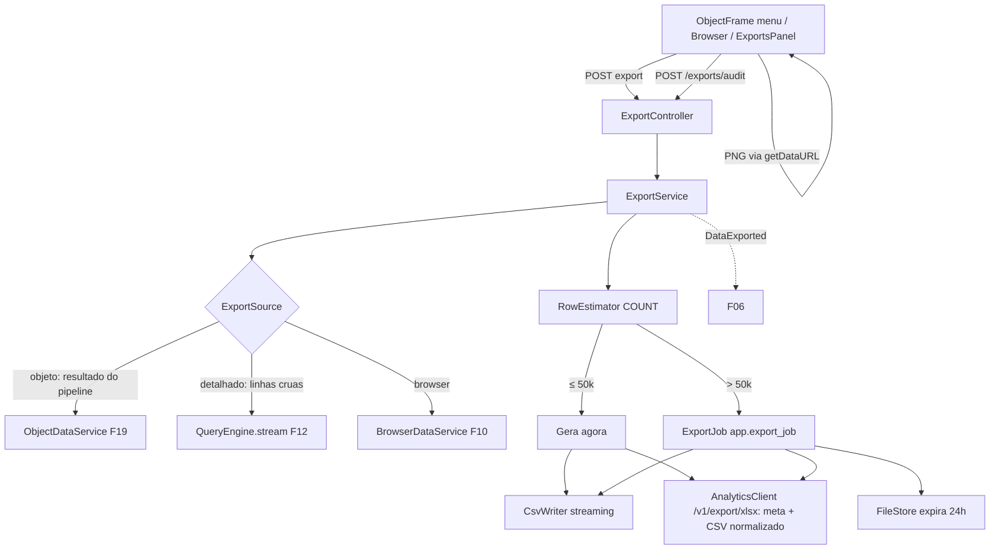

# F29 — Exportação Design

**Spec**: `.specs/features/F29-exportacao/spec.md`
**Status**: Draft

---

## Architecture Overview



---

## Code Reuse Analysis

### Existing Components to Leverage

| Component | Location | How to Use |
| --- | --- | --- |
| `ObjectDataService`, `ScreenFilterApplier` | F19 / F28 | Resultado "como na tela" e filtros |
| `QueryEngine.stream` | F12 | Linhas detalhadas sem limite de tela |
| `BrowserDataService` | F10 | Exportação da grade |
| `FileStore` | F11 | Arquivos assíncronos com expiração |
| `JobRunRecorder`, `MailService` | AD-015 / F03 | Job e e-mail |
| `DataExported` | `audit.api` (F06) | Auditoria |
| `@RequiresFlag(EXPORT)` | F04 | Permissão |
| Máscaras (`Mask` JSON) | F13/F14 | Formatos do Excel |

---

## Components

### `dashboard.export.ExportService` / `ExportController`

- `POST /screens/{id}/objects/{oid}/export` `{ format, detailed, filterValues }`, `POST /browsers/{id}/export` `{ format, filters, q, sort }`, `GET /exports`, `GET /exports/{id}`, `GET /exports/{id}/download`, `POST /exports/audit` `{ resourceType, resourceId, format }`.
- Decide síncrono × assíncrono pelo `RowEstimator` (detalhado e Browser: `COUNT(*)` da mesma consulta; objeto agregado: nº de linhas do resultado).
- Limite de 3 jobs simultâneos por usuário.
- **Location**: `backend/src/main/java/io/databoard/dashboard/export/`

### `dashboard.export.CsvWriter`

- Streaming em `OutputStream`: BOM, `;`, aspas RFC 4180, decimal com vírgula, datas `dd/MM/yyyy`, proteção contra injeção de fórmula, linha de aviso de truncamento.
- Modo `normalized` (para o analytics): `,`, decimal com ponto, ISO, sem BOM.

### `dashboard.export.ExportJobRunner` / `ExportCleanupJob`

- Job assíncrono → arquivo no `FileStore` (`purpose=EXPORT`, `expires_at=+24h`) → e-mail opcional; limpeza a cada hora.

### analytics — `export/xlsx.py`, `export/masks.py`, `api/v1/export.py`

- `POST /v1/export/xlsx` (multipart: `meta` JSON com colunas `{ key, label, type, mask }`, título, aviso, linha de total; `data` CSV normalizado) → `application/vnd.openxmlformats-officedocument.spreadsheetml.sheet` em streaming.
- `mask_to_excel_format(mask) -> str | None`; colunas TEXT com máscara formatadas como texto; proteção contra fórmula (`'` inicial); `constant_memory=True`; limite de corpo de 100 MB nesse endpoint.

### Frontend

- `features/screens/objects/ObjectExportMenu` (CSV, XLSX, PNG para gráficos, "Dados detalhados" CSV/XLSX; oculto sem `EXPORT`).
- `features/browser/BrowserExportButton`.
- `features/exports/ExportsPanel` (popover no topo; polling a cada 3 s enquanto houver `RUNNING`).
- `shared/download.ts` (download de blob e de `dataURL`).

---

## Data Models

```sql
-- V17__exports.sql
CREATE TABLE app.export_job (
  id uuid PRIMARY KEY, user_id uuid NOT NULL,
  resource_type varchar(20) NOT NULL, resource_id uuid NOT NULL, object_id uuid,
  format varchar(5) NOT NULL, detailed boolean NOT NULL DEFAULT false,
  request jsonb NOT NULL, status varchar(8) NOT NULL,
  file_id uuid REFERENCES app.stored_file(id) ON DELETE SET NULL,
  rows int, error_message text,
  created_at timestamptz NOT NULL DEFAULT now(), finished_at timestamptz, expires_at timestamptz);
CREATE INDEX ix_export_job_user ON app.export_job (user_id, created_at DESC);
```

---

## Error Handling Strategy

| Error Scenario | Handling | User Impact |
| --- | --- | --- |
| Sem `EXPORT` | 403 `FLAG_REQUIRED` | Opções ocultas |
| Objeto estático | 400 `EXPORT_NOT_SUPPORTED` | Opção ausente no menu |
| Analytics fora | 503 síncrono / job `FAILED` | Mensagem; tentar de novo |
| Expirado | 410 `EXPORT_EXPIRED` | Link desabilitado no painel |
| Muitos jobs | 429 `EXPORT_LIMIT` | "Aguarde as exportações em andamento" |

---

## Risks & Concerns

| Concern | Location (file:line) | Impact | Mitigation |
| --- | --- | --- | --- |
| Injeção de fórmula em CSV/XLSX | `CsvWriter`, `xlsx.py` | Execução de fórmula no Excel do usuário | Prefixo `'` para `= + - @` (e tab/CR iniciais); teste dedicado |
| `COUNT(*)` caro em visões LIVE | `RowEstimator` | Latência antes de exportar | Timeout curto (5 s) para a estimativa; se estourar, trata como assíncrono |
| XLSX de 100 mil linhas | analytics | Memória | `constant_memory` + streaming |

---

## Tech Decisions (only non-obvious ones)

| Decision | Choice | Rationale |
| --- | --- | --- |
| CSV no formato pt-BR para o usuário, normalizado para o analytics | Dois modos do mesmo writer | Excel pt-BR abre direto; o Python lê sem ambiguidade |
| PNG no navegador | `getDataURL` | Fidelidade e zero custo no servidor |
