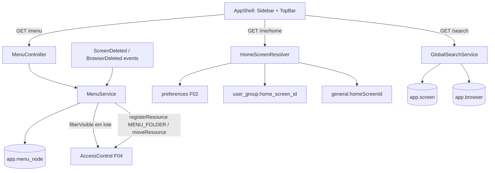

# F30 — Menus e Tela Inicial Design

**Spec**: `.specs/features/F30-menus/spec.md`
**Status**: Draft

---

## Architecture Overview



---

## Code Reuse Analysis

### Existing Components to Leverage

| Component | Location | How to Use |
| --- | --- | --- |
| `AccessControl` (`filterVisible`, `registerResource`, `moveResource`) | F04 | Visibilidade e herança |
| `user_group.priority` | F04 | Precedência da tela inicial |
| `preferences` + `PreferencesController` | F02 | `homeScreenId` do usuário |
| `GeneralSettings` | F02 | Adicionar `homeScreenId` global |
| Eventos de exclusão de tela/Browser | F19 / F10 (adicionar `ScreenDeleted`, `BrowserDeleted` se ainda não existirem) | Remover itens órfãos |
| `ExportsPanel`, `ThemeMenu`, `PasswordChangePage` | F29 / F02 / F03 | Barra superior |

---

## Components

### `navigation.menu.MenuService` / `MenuController`

- `GET /api/v1/menu`: carrega a árvore inteira (uma query), `filterVisible` por tipo (`SCREEN`, `BROWSER` numa chamada cada; `MENU_FOLDER` em outra), poda pastas vazias.
- `GET /api/v1/menu/admin-tree` (edição, sem poda, com permissões de edição por pasta), `POST /api/v1/menu/nodes`, `PUT /api/v1/menu/nodes/{id}`, `DELETE /api/v1/menu/nodes/{id}`, `PUT /api/v1/menu/order`.
- Herança: no primeiro item de um recurso, `AccessControl.moveResource(ref, folderId)` quando o recurso ainda não tem pai (exceto recursos com pai fixo, como Browser → UDT e visão do sistema → UDT, que mantêm o pai).
- **Location**: `backend/src/main/java/io/databoard/navigation/menu/`

### `navigation.home.HomeScreenResolver` / `HomeController`

- `Optional<UUID> resolve(CurrentUser)`: aplica a precedência com checagem de `VIEW`.
- `GET /api/v1/me/home`; `homeScreenId` em `PUT /groups/{id}` (F04) e em `general` (F02).

### `navigation.search.GlobalSearchService` / `SearchController`

- `GET /api/v1/search?q=`: `unaccent(lower(name)) LIKE unaccent(lower('%q%'))` em telas (não excluídas) e browsers; `filterVisible`; 20 resultados ordenados por "começa com" e depois alfabética.

### Frontend — `app/layout/`

- `AppShell` (Mantine `AppShell`): `Sidebar` com `MenuTree` (ícones, pastas recolhíveis, item ativo), `AdminMenu` por papel, `TopBar` com `GlobalSearch` (Spotlight do Mantine), `ExportsPanel` e `ProfileMenu` (tema, trocar senha, sair).
- `features/navigation/MenuEditorPage` (árvore arrastável com `@dnd-kit`, criar pasta/item, ícone, ACL da pasta via `AclEditor`).
- `features/navigation/HomeRedirect` (rota `/`), `WelcomePage`, ação "Usar como minha tela inicial" no `ScreenPage`.

---

## Data Models

```sql
-- V18__navigation.sql
CREATE EXTENSION IF NOT EXISTS unaccent;
CREATE TABLE app.menu_node (
  id uuid PRIMARY KEY, parent_id uuid REFERENCES app.menu_node(id),
  kind varchar(6) NOT NULL CHECK (kind IN ('FOLDER','ITEM')),
  label varchar(120) NOT NULL, icon varchar(40), position int NOT NULL,
  target_type varchar(10) CHECK (target_type IN ('SCREEN','BROWSER','LINK')),
  target_id uuid, url varchar(1000),
  created_by uuid, created_at timestamptz NOT NULL DEFAULT now());
CREATE INDEX ix_menu_node_parent ON app.menu_node (parent_id, position);
CREATE INDEX ix_menu_node_target ON app.menu_node (target_type, target_id);
ALTER TABLE app.user_group ADD COLUMN home_screen_id uuid;
```

---

## Error Handling Strategy

| Error Scenario | Handling | User Impact |
| --- | --- | --- |
| Pasta não vazia | 409 `MENU_FOLDER_NOT_EMPTY` | Aviso no editor |
| Ciclo/profundidade | 400 `MENU_CYCLE` / `MENU_TOO_DEEP` | Movimento recusado |
| Link inválido | 400 em `url` | Campo destacado |
| Sem permissão na pasta | 403 | Ações ocultas no editor |

---

## Risks & Concerns

| Concern | Location (file:line) | Impact | Mitigation |
| --- | --- | --- | --- |
| Mover pasta-mãe muda o acesso herdado de muitos recursos | `MenuService.order` | Acesso inesperado | Editor mostra aviso "N recursos herdam acesso desta pasta" antes de mover |
| Extensão `unaccent` indisponível | `V18__navigation.sql` | Busca sem ignorar acento | Fallback com `translate()` de acentos comuns se a extensão falhar |

---

## Tech Decisions (only non-obvious ones)

| Decision | Choice | Rationale |
| --- | --- | --- |
| Pasta-mãe = primeira pasta do item | Atalhos não mudam a herança | Um pai por recurso (F04) sem impedir o mesmo item em várias pastas |
| Menu calculado por requisição | Sem cache | Mudanças de acesso refletem imediatamente (AD-020) |
